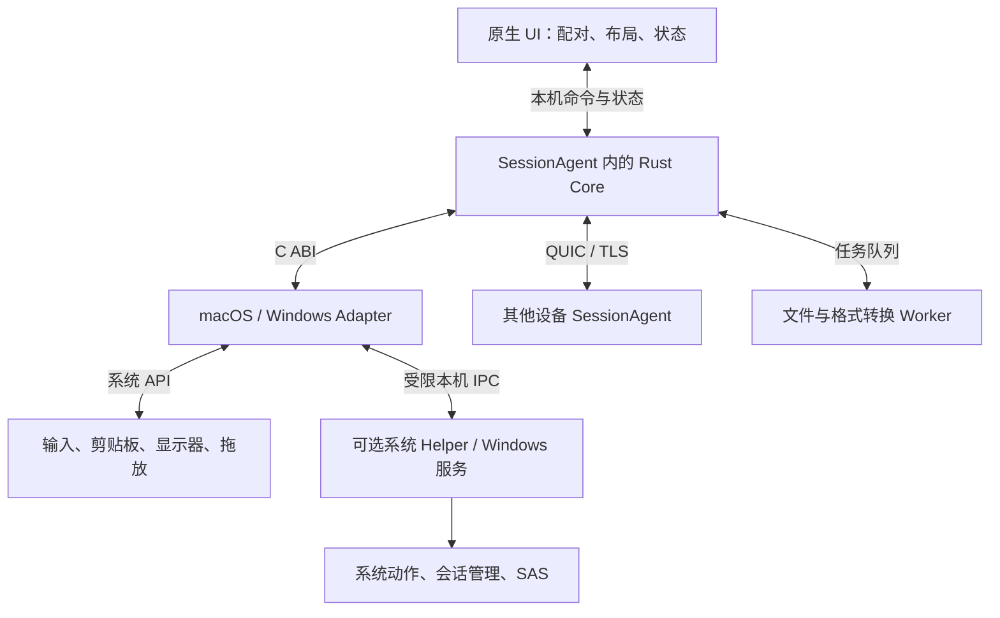
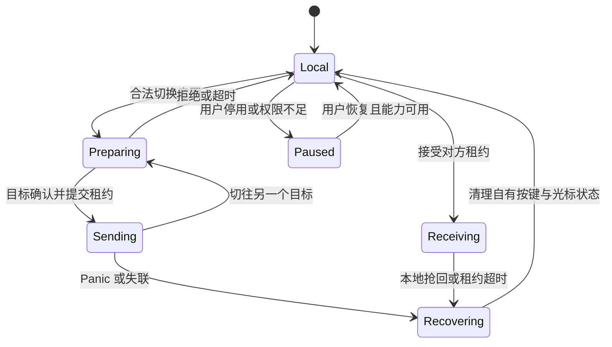

# ShareMouse Professional 功能与重构技术报告

版本：1.0 · 日期：2026-10-13 · 项目：OpenShareMouse

**用途：作为独立重构的产品规格、系统设计和验收基线。** 用户已确认：不要求与原版 ShareMouse 互联，优先功能等价；以 macOS 为首个实现平台，同时规划 Windows adapter。

报告覆盖专业版独有能力、其继承的基础能力、平台功能与配套运维。原软件内部实现来自 ShareMouse 7.0.30 ARM64 的 REA/Ghidra 静态证据；功能范围参考官方商店和文档。后文的自有协议、类型、超时、技术选型和测试目标均为**重构建议**，不是反编译得到的原版协议或性能。

**交付状态：报告 complete_with_limits；应用尚未实现、平台原型尚未验证。** 本报告可以用于拆分任务、定义接口及编写验收测试；不能当作原软件完整源代码恢复，也不能保证所有受限平台功能已经可行。

## 阅读导航

1. 目标、证据与设计决策
2. 完整功能清单（F01—F40）
3. 原实现的技术证据和重要修正
4. 重构架构与模块边界
5. 数据模型与能力协商
6. 控制权、跨屏算法与布局事务
7. 自有网络协议与配对
8. 输入事件管线
9. 剪贴板事务
10. 文件传输与拖放
11. 共享物理显示器与 DDC
12. 系统事件、登录与多用户
13. UI、配置、安装、更新与发布策略
14. 故障恢复、性能和测试
15. 分阶段实施、任务清单与完成判据
16. 未知项及补证计划
17. 平台 API 实施附录
18. 证据与来源索引

## 1. 目标、证据与设计决策

### 1.1 范围与非目标

实现“同一局域网的多台电脑共享键鼠、剪贴板和文件”，每台设备均可发起控制或接收控制。专业版容量参考为 **9 台电脑、16 个逻辑显示器**；这是本项目的容量测试目标，不要求复制原软件的付费容量限制。[S01]

显示器上仍显示所在电脑自己的应用。共享物理显示器通过输入源与布局切换实现；不传输屏幕视频、不迁移应用窗口。公网中继、Linux/移动端客户端、多人多光标协作、BIOS/固件阶段输入控制均不在本报告首版范围。[S10][S18]

实施基线建议：macOS 14+，先 Apple Silicon，随后验证 Intel；Windows adapter 以 Windows 11 x64 为首轮测试对象，Windows 10/ARM64 单独评估。它们是项目建议，不代表用户已指定系统版本或全部 API 已覆盖这些版本。

### 1.2 证据标记

| 标记 | 含义 | 可以据此断言什么 |
|---|---|---|
| B / E编号、N编号 | 已分析二进制中的静态代码 | 对应分支、调用、数据操作存在；不等于已运行成功 |
| R | 安装包 plist、nib、字符串 | 默认值、界面入口、配置声明存在 |
| O / S编号 | 官方产品页面 | 产品宣称的行为及版本边界；可能有旧文档冲突 |
| P | 平台官方 API 文档 | API 的公开契约；实际签名、权限和硬件仍需验证 |
| D | 本报告设计建议 | 新应用应该如何实现，不能归因于 ShareMouse |
| U | 未验证 / 未恢复 | 必须保留缺口，不能通过猜测补齐 |

E01—E40 与已有核心报告一致，N01—N11 是本次补充反编译。完整 ID、路径和调用位置见第 18 节。本文使用的每个毫秒阈值、队列上限和性能数值，除明确标为 B/R/O 外，均为 D，可在原型数据出来后调整。

### 1.3 目标身份

| 项目 | 值 |
|---|---|
| 原文件 | `/Applications/ShareMouse.app/Contents/MacOS/ShareMouse` |
| Bundle ID / 版本 | `com.bartelsmedia.ShareMouse` / `7.0.30` |
| 原文件 | universal Mach-O：arm64 + x86_64 |
| 原文件 SHA-256 | `5e6eb807f44038830b3a0cf738e685822fcdb12d51a08e4699ea603590c24de0` |
| 分析 slice SHA-256 | `b4cb84eb048718faa4edb3b29ba043eea3be31e5b456b04001481d432c712e66` |
| 分析工具 | REA，Ghidra 12.1.4 |
| 已有分析量 | 39 个函数伪代码，本次补充 11 个；未分析 Windows 二进制 |

未启动原应用、未修改原应用、未读取用户凭据、未做双机抓包。ARM64 结果不能自动视为 Intel 或 Windows 的同一实现。

### 1.4 已确定的设计决策

| ADR | 决策 | 理由 / 代价 |
|---|---|---|
| ADR-01 | 自有协议，功能等价，不实现原版互联 | 用户明确选择；可重新定义可靠性和认证 |
| ADR-02 | Rust 可移植核心 + macOS 原生 UI/adapter；Windows 后接入 | 拓扑和协议复用；平台输入、拖放仍需原生代码 |
| ADR-03 | QUIC 可靠流 + Datagram；可选 TCP/TLS 退化 | 输入状态可靠，移动可丢弃过时样本；需要维护两种 transport |
| ADR-04 | 已配对设备默认加密，能力按设备授权 | 不复制原版随包默认关闭加密的行为 |
| ADR-05 | 每个桌面一个有效控制租约；本地抢回优先 | 避免按键归属冲突；不支持同桌面多光标 |
| ADR-06 | 剪贴板正文按需获取，文件流与输入隔离 | 避免全网覆盖剪贴板与大文件挤占输入 |
| ADR-07 | 跨机文件首版只复制 | 无双端提交前不删除源文件；移动是独立后续需求 |
| ADR-08 | 登录、SAS、DDC、虚拟 HID 通过 capability 暴露 | 不用一个“管理员权限”标志承诺所有系统行为 |
| ADR-09 | 保留全部专业版需求，但按稳定/受限/实验分级发布 | 失败降级不等于已经实现原功能 |
| ADR-10 | 原商业授权独立记录；重构不依赖其许可服务 | 功能可全部开放；若未来收费，另设计自己的授权策略 |

## 2. 完整功能清单（F01—F40）

以下 O 层矩阵是截至核查日的范围基线。Standard→Pro 表示专业版继承；“归属未单列”不意味着免费版一定支持。后文将同一 F 编号连接到设计和测试。原版的试用菜单可能展示付费功能，不能由菜单存在推断当前授权。[S01][S02]


### 2.1 哪些是付费功能

| 范围 | Free | Standard | Professional |
|---|---|---|---|
| 电脑 / 显示器数量 | 2 / 2 | 2 / 合计最多 4 | 最多 9 / 合计最多 16 |
| 商业使用、文件拖放、剪贴板共享、密码保护 | 不含 | 包含 | 包含 |
| 多布局、共享显示器、系统事件同步 | 不含 | 不含 | 包含 |
| 防误切、左右环绕、尺寸补偿、Ctrl+Alt+Del | 不含 | 不含 | 包含 |

以上以当前官方商店为准。[S01] 免费版还受个人非商业使用条件限制。[S26] 专业版继承 Standard 能力；试用时看到全部选项不代表免费授权。商店与部分旧页面的数量示例不完全一致，容量以表格主规格为基线，见 §3.3。

### 2.2 逐项需求

#### 基础输入、设备与显示器

| ID | 功能 / 归属 | 官方行为证据 | 重构验收边界 |
|---|---|---|---|
| F01 | 双向键鼠共享；基础 | 任意电脑可控制其他电脑，无固定主从；Mac/Windows 混用。[Features][S03] | 每台可发起与接收；这不证明多用户可同时争用同一桌面。 |
| F02 | 边缘切换与自动定位；基础 | 初次触边推断目标方位；候选多屏用字母选择。[Remote control][S04] | 键盘焦点跟随当前鼠标目标；多候选必须确定目标。 |
| F03 | 多屏布局编辑；基础，容量依版本 | 拖动显示器位置；同机屏幕相对布局由 OS 决定，原版不允许跨机显示器插入另一电脑的屏幕组中。[Monitor Manager][S05] | 图标按像素分辨率，不等于物理尺寸；原版约束可作为兼容行为或明确改进项。 |
| F04 | 多屏容量；Pro | 商店上限 9 台 / 16 屏。[S01] | 这是参考产品容量验收目标；不必复制许可证限制。 |
| F05 | 独立显示器启停；v7，收费归属未单列 | 可从当前布局移除屏幕，并恢复全部屏幕。[Removing displays][S06] | 只是参与布局的开关，不等于从 OS 断开，也不能用于改变原版许可计数。 |
| F06 | 每屏热键；v7，收费归属未单列 | 每屏可绑定、移除独立切换键。[Hotkeys][S07] | 屏幕断开、热键冲突须给确定行为。 |
| F07 | QuickJump；收费归属未单列 | 单一目标直接跳转，多目标显示字母，选定后到目标中心。[Switching][S08] | 不等同每屏直接热键。 |
| F08 | 鼠标速度及滚动；收费归属未单列 | 鼠标、水平/垂直滚动速度可调，滚动可反向；Windows 可由应用绘制缺失的指针。[Output][S09] | 按目标平台设置，测试水平滚动与高 DPI。 |
| F09 | 媒体键；基础/归属未单列 | 播放、暂停、快进、回退、音量。[S03] | 不宣称任意厂商专用键。 |
| F10 | 手势与鼠标按钮；基础/归属未单列 | FAQ 列双指旋转/缩放；不支持更一般的多指手势；有左右中与前后侧键。[FAQ][S10] | `gestureact` 静态字符串不证明完整触控板手势透传。 |
| F11 | macOS 输入适配；平台项 | Windows 修饰键映射为 Mac 键；侧键可转 Back/Forward；IOHID 与 flags 模拟选项；Secure Input 提示。[Keyboard][S11] | macOS 不区分左右 Shift/Cmd/Ctrl 的原版限制见 [S04]；不能承诺绕过 Secure Input。 |
| F12 | 键盘布局与锁定键同步；v6/v7，归属未单列 | v6 自动语言布局同步；v7 Num/Caps/Scroll Lock LED 同步、远端指针 DPI 感知。[New][S12] | 各平台键盘 LED/语言切换需单独能力协商。 |
| F13 | 应急收回与临时停用；基础/归属未单列 | Panic 可一次/两次触发，默认 Esc；停用可通过菜单栏修饰点击或热键。[Misc][S13] [Pause][S14] | 持续按键必须释放，失联可恢复本机输入；这些是重构验收补充。 |
| F14 | 暗化和方向提示；归属未单列 | 非活动屏可暗化，方向箭头与暗化关联；历史 v5 宣称硬件暗化。[S13] [S12] | 当前静态资源不能证明所有显示器均使用硬件亮度控制。 |

#### Professional 的拓扑与切换策略

| ID | 功能 / 归属 | 官方行为证据 | 重构验收边界 |
|---|---|---|---|
| F15 | 多布局档案；Pro | 多套排列可命名、创建、删除，菜单或热键切换。[Profiles][S15] | 同一设备集合可保存不同布局。 |
| F16 | 工作场所自动切换；Pro | 环境变化时自动恢复对应布局。[S15] | 官方未公开匹配键、冲突优先级；应自行定义设备/屏幕指纹算法。 |
| F17 | 共享物理显示器；Pro | 同一物理屏由不同电脑分别上报，用户合并图标并形成各输入布局，分辨率可不同。[Shared display][S16] | 不是屏幕画面网络串流。 |
| F18 | DDC 自动输入切换；Pro 配套实验项 | 为电脑映射输入源后，布局切换可切换硬件输入；无 DDC 时可手动切换。[S16] | **官方明确为实验性附赠，非正式产品规格**；硬件/转接器兼容矩阵需实测。 |
| F19 | 防误切；Pro | 全屏、最大化、角落、修饰键条件；双触边可覆盖上述阻挡。[S08] | 特定应用排除见 v5 新功能 [S12]；规则顺序、阈值未由官方公开。 |
| F20 | 环绕；Pro | 最左/右边缘跳到相对边缘。[S08] | 不由此扩大为任意拓扑的上下环绕承诺。 |
| F21 | 尺寸补偿；Pro | 不相邻重叠的边缘“死区”映射到可达屏幕区域。[S08] | 不等于按物理毫米补偿、色彩校准或真实 DPI 统一。 |

#### 数据交换、安全与网络

| ID | 功能 / 归属 | 官方行为证据 | 重构验收边界 |
|---|---|---|---|
| F22 | 按需剪贴板；Standard→Pro | 远端粘贴时才传给该电脑，不在复制时全网覆盖；支持独立远端粘贴热键。[Clipboard feature][S17] | 通知剪贴板变化与传输正文必须分开。 |
| F23 | 剪贴板数据格式；Standard→Pro | 文件、纯文本、富文本、位图；Mac/Windows 格式互转有差异。[Clipboard doc][S18] | 菜单粘贴使用本地内容，远端需要热键；HTML 无 RTF 时 Mac 可降级为纯文本。 |
| F24 | 文件/目录拖放；Standard→Pro | 支持一个或多个文件/目录，较大传输有进度条。[Drag/drop][S19] | 断点续传、强校验、原子提交等未被此官方说明确认，可作为新实现增强。 |
| F25 | 富文本/位图跨应用拖放；v5，付费数据交换范畴 | 历史新功能页列出跨 Mac/Windows 应用拖放。[S12] | 当前拖放指南主要描述文件；格式与目标应用兼容性需专项测试。 |
| F26 | 密码工作组和加密；Standard→Pro | 同密码客户端互连；密码自动启用 AES-128-CBC，覆盖输入、剪贴板、文件。[Network][S20] | 这是官方算法声明；本机 REA 尚未完整核实密钥派生/认证/密文完整性。新协议不必复刻。 |
| F27 | 广播发现、端口、网卡；基础/归属未单列 | UDP 1046 发现，TCP 6555；可改端口、偏好网卡，偏好接口掉线有回退。[S20] | 输入控制 TCP/UDP 精确分工应取 REA，不只引用文档。 |
| F28 | 手动连接；基础/归属未单列 | 可禁广播，配置 IP+端口和显示连接状态；固定远端 IP 不自动切换远端网卡。[Client management][S21] | 区别于本地偏好网卡回退。 |
| F29 | IPv6；v6，归属未单列 | 新功能页明确列 IPv6。[S12] | 未给组播发现或双栈择优细节。 |

#### 系统整合、安装与运维

| ID | 功能 / 归属 | 官方行为证据 | 重构验收边界 |
|---|---|---|---|
| F30 | 系统事件同步；Pro | 关机、挂起、锁定带倒计时；屏保联动。[Exchange][S22] | 挂起设备须本地唤醒；注销/关机信号可能混淆；不应直接复制危险的误判行为。 |
| F31 | 自动登录/解锁联动；Pro，平台限制 | 使用已配置凭据；文档明确不适用 macOS 10.14+，便携模式也不可用。[S22] | 现代 Mac 应列受限/探索项，不因旧插件或 UI 存在承诺可用。 |
| F32 | Windows 冷启动登录屏控制；平台项 | 已启动 Windows 后可用远端键鼠输入登录。[Remote login][S23] | 不包括 BIOS、BitLocker 启动前、OS 未启动时的控制。 |
| F33 | Windows 服务 / UAC / 跨权限输入；平台项 | 安装服务支持 UAC、不同权限程序间控制、登录/锁定/关机同步及自动更新。[Install][S24] | 单用户无管理员安装和 portable 缺服务能力。 |
| F34 | Windows Ctrl+Alt+Del；Pro | 使用另一个自定义热键请求远端 SAS，要求服务启动。[S13] | 普通键盘事件注入不能等价替代。 |
| F35 | Windows Fast User Switching；平台项 | 功能页明确宣称支持。[S03] | 多 OS 用户会话切换，**不等于同一桌面多光标并发协作**；现代 macOS 多用户等价性未知。 |
| F36 | macOS 登录窗口控制；条件能力 | 键盘文档声明启用 IOHID 模拟时不能控制 Login window。[S11] | 与自动凭据登录 F31 分开；有代理并不代表在当前系统上已验证可用。 |
| F37 | 安装、权限、便携模式；通用/平台项 | Mac 要求辅助功能与完全磁盘访问；Windows portable 不安装服务。[S24] 下载页也给 Mac portable。[S02] | 新实现应按实际 API 最小化权限；不能把原产品权限申请当系统全部必要条件。 |
| F38 | 更新渠道与自动安装；运维 | 可关闭检查或选重要/次要/实验/Beta；下载后下次启动安装；支持代理。[Internet][S25] | 官方要求组内同版本；新实现应自行定义向后兼容/降级策略。 |
| F39 | 局域网更新分发；v6，归属未单列 | v6 新功能明确本地更新分发及安装。[S12] | 分发协议、包签名校验、故障恢复无公开细节。 |
| F40 | 许可、维护和试用；商业配套 | 见本节前版本关系。[S01] [S02] | 原版商业系统不是功能等价必需，可使用自有发布策略，不接入或仿制其许可服务。 |


## 3. 原实现的技术证据和重要修正

### 3.1 主要模块与调用链（B）

| 子系统 | 观察到的类 / 函数 | 已证实的工作 | 证据 |
|---|---|---|---|
| 输入捕获 | `InputHook::hookProc:`，`0x10003d6d8` | 创建 CGEventTap、绑定 RunLoop、输入阻止通知 | E04、E40 |
| 输入发送 | `procKeyHook:isInjected:`、`udpMouseMove:y:` | 键码转换、热键处理、按当前目标发送输入 | E05、E06 |
| 输入接收 | `handleUDPReceiveEvent:`，`0x10003348c` | 按命令分发键、鼠标、滚轮、字符及手势 | E07、E08 |
| 注入 | `FUN_10003f104`、`FUN_10003f024`、`FUN_10003eae4` | CoreGraphics 与 IOHID 两条分支 | E09—E13 |
| 拓扑 | `MonMan`、`MonitorView`、`findSwitchMonitor…` | 坐标映射、邻边选择、自动定位及选择 UI | E12、E15、N09 |
| 切换 | `tcpSwitch:pt:` 及 `0x1000145ec` block | 目标状态、UDP 端口、键状态、拖放及暗化协调 | E16、E17 |
| 发现 | `udpIntroduce`、`procAddClient:params:` | 广播宣告、检查模式、创建连接 | E18、E19 |
| 控制通道 | `smHandleDecodedLine`、`smDispatchCommand` | CRLF 命令与参数解析、控制/布局/传输分发 | E20—E22 |
| 剪贴板 | `startClipboardWatcher`、`onClipboardTimer`、`TCPGetData` | 1 秒检测变化、通知、独立获取和多格式恢复 | E24—E29 |
| 远端拖拽 | `RemoteDropCoordinator` | NSFilePromiseProvider + NSDraggingItem；目标请求后启动传输 | N06、N07 |
| 布局存储 | `MonMan::loadLayout`，`0x10004c850` | XML 路径选择、v7/v6/v5/旧格式分支、active sublayout | N10 |
| 键盘同步 | `procSyncKbd:`，`0x10001b96c` | 条件同步 Caps Lock 及语言布局 | N11 |
| 应急恢复 | `doPanic`、`resetControl` | 计数/时间条件、焦点恢复、hook 与网络重建 | N04、N05 |
| 加密 | `encodeLine`、`encodeUDPString`、接收器 | 条件加解密调用，包含固定 IV 字面量参数 | E20、E29—E31 |
| 系统同步 | `procChangeState`、`continueChangeState` | 开关、确认及系统动作分支 | E34—E36 |
| 输入源 | `procMonitorInputSource`、`handleInputSourceSwitch` | 通知后携显示器 ID 与 `0x60` 进入 DDC 包装函数 | E37—E39 |
| 付费提示 | `checkLowLicense`、`expiredStringWithString:` | 按使用标记、数量、状态同步等生成超授权提示 | N01、N02 |

有恢复价值的事实：原程序把多种业务放入 `AppController`，但重构不宜照搬成一个巨型 controller；异步 block 与 Objective-C 消息使调用关系不完整，名称也不能自动证明调用可达。`NSFilePromiseProvider` 已有代码证据，仍未证明任意源应用拖拽接管都可成功。路径清理函数 N08 存在，不代表整个文件通道已通过目录逃逸测试。

### 3.2 原版通道划分与重构取舍

B：UDP 命令包括 `rc_iamhere`、`mousemove:%d,%d`、`keyact:%d,%d,%d,%d`、`wheelact`、`gestureact` 及移动反馈。TCP 命令包括 `switch`、`stopcontrol`、`resetcontrol`、布局命令、`clbchanged`、`clbget`、`getdragfiles` 等；大数据通过长度驱动的读取处理。E07、E20—E23、E29。

R：随包默认 TCP=6555、UDP=1046、广播/剪贴板/拖放/IOHID 模拟开启、加密关闭、系统同步关闭；这些不是当前用户配置。E32。

D：自有协议保留“控制可靠、移动及时、批量数据隔离”的分工，但按键边沿使用可靠流，移动使用携绝对位置的 Datagram。无需解析原版字符串报文或复用它的端口、许可证格式、证书、密钥。

### 3.3 必须保留的产品边界

| 问题 | 证据冲突 / 限制 | 本报告处理 |
|---|---|---|
| 屏幕数量 | 当前 Shop 为 Pro 9 台/16 屏，旧 FAQ 数量不同 | 按 Shop 定容量验收，不混合数字 [S01][S10] |
| 加密 | 官方称密码启用 AES-128-CBC；静态仅确认调用链与 IV 参数 | 原算法不视为完整恢复；新协议使用标准传输层认证加密 [S20] |
| macOS 自动登录 | 官方 Exchange 文档列 macOS 10.14+ 不适用；包仍有代理/插件/UI | 自动凭据登录列受限；手工登录窗口控制另验 [S22] |
| DDC | 收费共享屏功能旁的自动切源被明确列为实验性附赠 | 可选硬件 adapter；不能宣称所有显示器支持 [S16] |
| 手势 | 有 gestureact 实现；官方只列部分双指手势 | 旋转/缩放逐平台验收，不承诺任意多指透传 [S10] |
| 富文本内嵌图 | 历史 New 页与现行 Clipboard 指南存在平台差异 | 建立格式×来源应用×目标应用测试矩阵 [S12][S18] |
| 多用户 | Windows Fast User Switching 不等于多操作者同桌面 | 会话隔离与控制竞争分别设计 [S03] |
| 显示器尺寸补偿 | 原版意在消除切屏死区 | 不等同物理尺寸校准；本项目明确采用边缘映射策略 [S08] |

## 4. 重构架构与模块边界（D）

### 4.1 部署与进程



- **UI**：展示连接、授权、拓扑、传输进度；UI 退出或卡顿不应把用户永久留在远控状态。首版可与 agent 同进程，但必须维持相同模块边界。
- **SessionAgent**：每个 OS 交互会话一份；core 作为库运行，持有输入捕获、控制租约、配置快照和 peer 会话。网络 payload 在普通权限进程解析。
- **SystemHelper**：只暴露枚举化动作和必要会话操作；Windows 服务不在 Session 0 绘制 UI。macOS 登录窗口 adapter 是独立实验目标。
- **File/Format Worker**：可以先用线程池；大图转换/复杂格式解析以后可独立进程，避免阻塞输入与租约心跳。

### 4.2 技术栈与构建形态

| 层 | 建议选型 | 限定 |
|---|---|---|
| core | Rust，事件驱动 actor | 无 OS UI 类型；时间、随机源、transport 可注入 |
| transport | Quinn + rustls / QUIC；独立 TLS stream adapter 可后置 | 版本在实施时锁定；本报告不提供假定已验证的依赖版本 |
| macOS | SwiftUI 设置壳 + AppKit/Objective-C/Swift 平台层 | event tap、drag session、pasteboard 使用原生对象生命周期 |
| Windows | C# 原生桌面壳 + Win32 adapter，或统一 C/C++ 平台桥 | 核心通过 C ABI；特权服务与会话 UI 分离 |
| 数据编码 | Protobuf 消息 + 明确的长度封包 | 不把 Rust 内存结构直接序列化上线 |
| 配置 | 带 schema_version 的 JSON、原子替换 | 不为小规模布局引入跨设备数据库 |
| 密钥 | Keychain / Windows 受保护存储 | 公钥标识与敏感私钥分开；凭据不进普通 JSON |

Quinn 提供可靠流与不可靠 datagram；datagram 大小和发送缓冲必须按连接返回的能力处理。它本身不替应用保证输入延迟或优先级，需要应用层预算与限流。[T01][T02][T03]

### 4.3 模块与线程契约

| 模块 | 拥有状态 | 入口 / 输出 | 线程规则 |
|---|---|---|---|
| `device_registry` | peer 身份、地址、会话、capability | discovered / paired / connected | 单 writer |
| `session_core` | 控制租约、epoch、按键账本 | switch intent / committed input | 一个 actor 串行决策 |
| `topology` | profile、显示器图、边缘映射 | snapshot / candidate target | 不可变快照，纯函数求解 |
| `input_router` | 过滤策略、队列、序号 | native event → wire input | hook 内仅无阻塞 enqueue 与抑制判定 |
| `transport` | stream、连接和限额 | validated envelope / send request | async runtime，禁止调用 UI |
| `clipboard` | offer、generation、paste transaction | offer / request / publish | IO 与 UI 平台线程按接口拆分 |
| `transfer` | manifest、chunk、staging、取消 | offer → commit / failure | 有界 worker pool |
| `drag_bridge` | source/target OS drag session | drag intent / drop accept | AppKit/COM 亲和线程 |
| `system_sync` | 去重 action、倒计时、权限 | action request / result | helper 调用异步 |
| `settings` | 配置版本和迁移 | validated snapshot | 写入串行、fsync + rename |
| `diagnostics` | 指标与事件日志 | structured event | 不记录输入正文 |

远控开始前，core 向 hook 安装原子快照 `ForwardPolicy`。hook 必须在回调返回前决定本机是否接收事件，不能先吞输入再等网络线程决定。若 enqueue 失败、租约失效或快照异常，进入恢复路径，恢复本地分发；不要为了“无丢包”阻塞 hook。

目标 adapter 用 `RemoteHeldKeys` 和 `LocalHeldKeys` 的组合状态决定实际按下/释放；只释放本应用归属的按键，不能把用户本机正按住的修饰键强行释放。原生 OS 无法完美分离来源时须在平台测试中披露限制。

仓库结构和可直接拆分的任务见 §15.2–15.3。

## 5. 数据模型与能力协商（D）

### 5.1 核心类型

| 类型 | 必需字段 | 不变量 |
|---|---|---|
| `DeviceIdentity` | `device_id`、公钥指纹、display_name | device_id 由设备公钥身份派生，不使用 IP 标识设备 |
| `SessionIdentity` | device_id、session_id、boot_id | 用户登出/重启后新 session，不复用旧控制权 |
| `Peer` | identity、addresses、trust、connection_state | 地址只是可替换路由信息 |
| `Display` | stable_display_id、runtime_id、logical/native bounds、scale、rotation | runtime_id 不持久化为唯一身份 |
| `PhysicalDisplayGroup` | group_id、各设备的 display endpoint、input mapping | 合并物理屏需用户确认；相同 EDID 不足以自动合并 |
| `LayoutProfile` | id、revision、name、environment_key、placement、edges、hotkeys | profile 修改不直接改变 OS 显示器排列 |
| `ControlLease` | lease_id、owner_session、target_session、epoch、layout_revision、TTL | target 只接受一个生效 lease；epoch 单调不回退 |
| `InputState` | owned_keys、buttons、modifiers、pointer、reliable_seq | 每次注入都属于当前 lease |
| `ClipboardOffer` | origin、offer_id、generation、formats、size_hints、expiry | generation 只在来源端比较 |
| `TransferJob` | transfer_id、source、target、manifest_hash、items、state | 未提交的 staging 内容不作为最终文件 |
| `SystemAction` | action_id、origin、kind、deadline、confirmation、result | 相同 ID 至多产生一次已执行动作 |
| `Capability` | name、version、state、reason、scope、probe_time | advertised 与实际可用分开；变化触发重协商 |

`Capability.state` 枚举：`available`、`permission_required`、`unsupported`、`temporarily_unavailable`、`experimental`。`verified` 是测试证据属性，不是替代这些运行状态的一个布尔值。

至少协商：`input.keyboard.physical`、`input.text.commit`、`input.pointer.absolute`、`input.pointer.relative`、`input.scroll.precise`、`input.media`、`input.gesture.rotate`、`input.gesture.magnify`、`keyboard.layout.sync`、`keyboard.lock.caps/num/scroll`、`clipboard.<format>`、`drag.files.source/target`、`drag.richdata`、`display.input.ddc`、`session.login_input`、`system.sas`、`system.<action>`。

能力声明来自 adapter 探针，**不是**读取平台名称后固定返回。配对许可另列 `allowed_actions`；可用能力与允许能力取交集，才能实际执行。

### 5.2 坐标契约

core 使用设备内统一的逻辑桌面空间：左上原点，x 向右、y 向下，单位为显式逻辑单位，可负数。每个 display 带独立 adapter transform 到本机 API 坐标。AppKit points、Quartz 坐标、Windows DPI 虚拟化坐标和物理 pixels 不得混放。

wire 的定位使用 `display_id + x_norm + y_norm`，归一化范围 `[0,1)`；旋转由目标 transform 处理，落点 clamp 到有效像素。移动轨迹内部保留浮点精度，只有 API 边界取整。指针速度与系统加速必须只应用一次。

显示器身份优先 OS 持久标识，再组合型号/序列/连接路径；缺序列的同型号双屏不猜测，允许用户重关联。每次热插拔、旋转、缩放变化增加 `topology_revision`。旧 revision 的输入不静默套入新的屏幕布局。

### 5.3 环境与布局配置示例

```json
{
  "schema_version": 1,
  "profile_id": "office-desk",
  "revision": 7,
  "name": "办公室",
  "environment": {
    "required_endpoints": ["mac-a/display-main", "pc-b/display-main"],
    "optional_endpoints": ["mac-a/display-side"]
  },
  "placements": [
    {"endpoint": "mac-a/display-main", "x": 0, "y": 0, "w": 1440, "h": 900},
    {"endpoint": "pc-b/display-main", "x": 1440, "y": 0, "w": 1920, "h": 1080}
  ],
  "switch_policy": {
    "edge_enabled": true,
    "mapping": "overlap_then_proportional",
    "wrap_horizontal": false,
    "block_fullscreen": false,
    "block_maximized": false,
    "block_corner_dip": 16,
    "modifier_requirement": [],
    "excluded_apps": [],
    "double_hit_override": false
  },
  "clipboard": {"mode": "on_demand", "remote_hotkey": "platform+shift+v"},
  "transfers": {"operation": "copy", "conflict_policy": "keep_both"},
  "system_sync": {"enabled_actions": []}
}
```

此例是本项目格式；endpoint 是示意名称，不是原软件真实标识。将远端粘贴默认设为额外修饰键是 D，刻意保留系统普通粘贴，不照搬原包 Cmd+V 默认值。

## 6. 控制权、跨屏算法与布局事务（D）

### 6.1 状态机



- `Sending` 与 `Receiving` 在同一 session 互斥。被远控时不再将注入事件当物理来源转发。
- 多组设备可同时形成互不相交的控制对；同一桌面不同时接收两个操作者。
- 并发请求采用 target actor 串行裁决：有效租约存在即 BUSY，不做抢占等待；本机物理输入按配置主动撤销远控，Panic 永远可抢回。
- 两台机器同时互相申请，双方 Preparing 状态默认拒绝入站请求并随机短退避；无分布式锁互等。若希望更平滑，可定义 device_id 次序打破平局，但必须所有实现一致。

### 6.2 A→B→C 切换事务

1. A 是物理输入来源，控制 B。B 只注入，不重新捕获发送；逻辑指针轨迹由 A 的 core 维护。
2. 指针碰到 B→C 的合法边，A 向 C 发 `LEASE_PREPARE`，附 topology revision、目的显示器、切入位置及受支持事件集合。
3. C 校验身份、许可、权限、桌面状态与冲突；返回有时限的 reservation，**此时不能注入**。
4. A 停止向 B 发送新事件，发送 `RELEASE_ALL` 和 `LEASE_RELEASE`；B 释放 A 拥有的按键/按钮，返回 RELEASED。
5. 只有收到 B 的 RELEASED，或通过查询确认旧租约已过期后，A 才向 C 提交 `LEASE_COMMIT`。C 返回 ACTIVE 后，A 切换抑制/路由快照。
6. A→B 的旧 epoch 报文在 B 丢弃；C 新 epoch 从可靠序号 1 起。未决按键状态按下述规则恢复。

若旧 B 的释放 ACK 丢失，A 不可把“本地时间等待一次 RTT”当 B 已释放。重发幂等 RELEASE；无法确认则取消 C 的 reservation、停止旧 heartbeat 并恢复 A 本地。TTL 由 B 本地处理，且只接受当前连接、递增序号的有效续期；进入 expired/released 后，迟到 heartbeat 不得复活。由于单向黑洞和网络排队，A 不能只等一个固定 TTL 就断言 B 已释放；严格切换流程须在重新连通后查询到 B 的旧 epoch 已释放/过期，再重新 PREPARE 并提交 C。后续若要离线跨目标接管，需另行设计带可验证截止界限的续租协议并证明上界。

在 C PREPARE 失败且 B 未释放时可留在 B；B 已释放后 C COMMIT 失败就回本机，不向两个目标补发输入。跨机切换不实现未经验证的“原子同时控制两台”。

普通切换可携物理按住键 snapshot，但先释放旧目标，再在新目标同步，不能重放历史输入队列。发生断线、权限撤销、睡眠或 Panic 时，重新连接**不恢复**旧按住键。文件拖动须有有效 drag transaction 才可跨目标保留按钮状态，否则明确取消。

### 6.3 租约与超时初始值

| 参数 | 初始建议 | 目的 |
|---|---|---|
| heartbeat interval | 250 ms | 只对活跃控制 lease 高频保活 |
| target TTL | 1500 ms | 无续期后释放本应用持有状态 |
| prepare timeout | 1000 ms | 边缘切换不无限挂起 |
| reservation expiry | 2000 ms | 避免未 commit 占用目标 |
| 输入队列陈旧阈值 | 100 ms | 过时移动丢弃；可靠事件不能简单丢弃 |
| 接收端 release budget | 100 ms 目标 | 本机排队清理，不含系统 UI 完成时间 |
| topology debounce | 500 ms | 合并热插拔抖动，但输入先进入安全暂停 |

这些是待测初始值。释放延迟验收从“最后一次目标接受有效 heartbeat”计算；不能在单向黑洞中宣称从拔网线瞬间严格 1500 ms。进程被操作系统长时间停调度时也需要另外记录恢复时间。

### 6.4 邻接、尺寸补偿与环绕

正常模式先求源边与目标反边的投影重叠区间；候选必须在线、已配对、可注入且在当前 profile 中启用。多个目标同边时按边的区间决定；区间重叠冲突必须在布局编辑器提示，不用设备数组遍历顺序决定。

右边跨越示例，源有效段为 `[s0,s1)`，目标映射段为 `[d0,d1)`：

```text
t = clamp((sourceY - s0) / (s1 - s0), 0, 1 - epsilon)
targetY = d0 + t * (d1 - d0)
targetX = target.left + inset
```

`inset` 建议 2 logical units，`epsilon` 按目标最小可表示位置计算；零长区间拒绝。原版主路径出现 `<2` 邻边距离和 10 单位切入，见 E15，但这些不作为新协议常量。

尺寸补偿启用时，将源边死区投到配置的可达目标段；默认先使用正常重叠段，补偿部分采用比例映射。多个可达候选以显式 edge mapping 优先、距离其次、stable id 最后定序，并记录用户可解释的路由。只消除死区，不假装识别真实屏幕厘米尺寸。

水平环绕在正常邻接无候选时，从布局最外侧映射到另一端；匹配相同边投影区间。只启用左右环绕作为原版对应基线，上下环绕是可选增强。防抖：切换后在目标内部移动 8 logical units 或经过 150 ms 后才重新允许反向触边；不能因此阻止 Panic。

### 6.5 防误切、热键与选择优先级

处理顺序固定：Panic → 会话/权限/租约有效性 → 本地用户抢回 → 拖拽策略 → 应用排除 → 全屏/最大化/拐角 → 必需修饰键 → 可选双触边覆盖 → 几何目标 → PREPARE。

双触边只覆盖明确配置的防误切项，不能覆盖未配对、权限不足或屏幕离线。建议 350 ms 内第二次触边，且两次之间退回边内 8 logical units；这是新设计。最大化/全屏识别失败时 UI 显示未知，不静默视作没有全屏。

QuickJump 单目标直达，多目标显示临时字母选择；每屏热键直接产生同一 `SwitchIntent`，不用另一套控制链路。快捷键冲突在保存时检测；不能抢占系统保留组合后才报错。

### 6.6 布局档案、自动恢复与编辑冲突

环境匹配采用已配对设备身份+稳定显示器集合，区分 required/optional endpoint；新设备出现不自动覆盖原布局。选择顺序：当前用户手选并锁定的 profile → required 完全匹配且 optional 命中最多 → 最近使用 → 提示用户。设备短暂掉线只标离线，不删除配置。

布局由明确的 editor 设备持有当前编辑会话；修改提交为 `base_revision → new_revision`，冲突返回 CONFLICT，不进行最后写入者静默覆盖。各参与设备 ACK 新 revision 后在无活跃切换事务的边界激活；不兼容时保留旧布局或安全本地模式。

同机显示器相对坐标由 OS 决定，布局编辑器移动的是设备屏幕组和跨机边；这样与原版行为基线接近。[S05] 若以后允许拆散屏幕组，应作为新功能显式实现映射。

## 7. 自有网络协议与配对

本节全部是 D。协议代号 `OSM/1`，与 ShareMouse 的报文、端口及授权系统无兼容关系。

### 7.1 发现与连接

- 默认在用户允许的本地接口使用 mDNS/DNS-SD 发布服务；候选服务类型 `_opensharemouse._udp` 是项目私有约定，发布前需核对服务名注册要求。发现只携带协议版本、显示名称、临时发现 ID 和端口，不携带剪贴板、输入或凭据。[T05][T06]
- 建议初始端口 `49001`，可配置；这只是项目默认值，不声称已获得 IANA 专用分配。手动连接接受 DNS、IPv4、带 scope 的 IPv6 link-local 地址。关闭发现后仍可手动连接。
- 地址是路由信息，公钥身份才是设备身份。多网卡发现、IPv4/IPv6 和重连结果按已认证 `device_id` 去重；连接到同名但新证书的设备不能继承授权。
- 偏好接口不可用时，可按用户配置回退到其他允许接口。网络类别/接口白名单发生变化应重新计算监听和通告范围；不自动扩展到公网。
- 最多 9 台形成至多 36 对连接关系；控制连接保持低频心跳，文件数据连接按需建立。连接风暴按设备抖动退避，单对双向同时建连通过稳定身份排序保留一条。
- 节点不承担任意中继。A 的键鼠经 B 显示切向 C 时，仍是 A 与 C 直接通信。防火墙阻断时显示具体连接错误，不伪装成功发现即已可控制。

### 7.2 信任与密码工作组

初次配对默认显示设备名、公钥指纹及一次性配对二维码。二维码包含协议版本、完整指纹、连接候选和至少 256 bit 随机 token；token 仅一次使用，建议 5 分钟过期，完成前不得授予输入能力。扫描端核对对端完整指纹；被配对端确认发起设备，双方将公钥和能力授权写入本机信任库。手工配对走同一认证状态机，短码只作用户校验，不能单独充当长期密码。

为保留 F26 的“相同密码加入工作组”体验，另外设计密码工作组模式：使用经审查的 PAKE 实现、明确的套件和测试向量，将组标识、双方角色、协议版本及长期公钥绑定到认证 transcript，并执行双向 key confirmation。SPAKE2 的 RFC 9382 可作为候选技术资料，但它是 IRTF Informational，**本报告未选定可发布的库及参数**。[T07] 密码模式必须通过专门原型和审查后才标为已实现；不能用 `SHA256(password)` 作固定网络密钥或自己设计 challenge 算法。

配对成功后使用绑定设备身份的 TLS 认证；QR 与密码工作组只负责可信引导。私钥存入平台凭据存储或受其保护的加密文件。更换密码是否撤销旧配对必须明确：建议默认撤销密码组签发的成员授权，保留用户单独批准的配对并列出差异。遗失设备由用户显式撤销；已建立连接也应立即关闭并释放控制权。

每台设备独立授权 `input / clipboard / file_receive / system_sync / login_control`，首次只启用用户选择的能力。证书变化、过期 token、未知设备和认证失败均不得进入控制状态。调试日志只记录身份短指纹和错误，不记录键入内容、密码、剪贴板正文或文件内容。

### 7.3 通道及顺序

QUIC 提供有序可靠流；QUIC Datagram 本身不保证顺序或重传。[T01][T02][T04] Quinn 可提供 stream、datagram 和发送额度接口，但库 API 并不自动实现本报告的输入优先级。[T03]

| 通道 | 内容 | 顺序 / 可靠性 |
|---|---|---|
| control | 能力、布局 revision、租约、系统动作 | 单个可靠有序流；小消息优先 |
| input-state | key/button/wheel/text、状态校验、释放 | 每租约一个可靠有序流；严格序号 |
| pointer | 当前绝对位置或累计位移快照 | Datagram，带 epoch、sample_seq、reliable_seq fence；旧样本丢弃 |
| clipboard | offer 与 request 控制；正文单独流 | 请求/提交有序，正文可取消 |
| bulk | 文件 manifest、chunk、校验和提交 | 独立低优先数据连接或受限连接池；并发有限 |
| update | 已签名更新包缓存 | 按 bulk 处理，最低优先 |

输入和 bulk 使用独立拥塞预算；即使底层分开连接，也要在应用层限速，不能假设两条连接就天然不竞争无线链路。初始 bulk 并发 2 个 stream，输入 RTT 上升时自适应降速。Datagram 实际大小不超过 `min(1200, negotiated_max_datagram_size)`；缓冲不足时合并移动，不能阻塞捕获回调。

UDP 被阻断时可降级为 TLS/TCP：控制、输入和 bulk 用分离连接，移动在写入前合并。TCP 重传仍可能引起输入头部阻塞，因此 UI 标记 transport 与延迟状态；不能宣称降级后仍具有完全相同的实时性。

### 7.4 帧与消息字典

可靠控制帧：`u32_be length + protobuf Envelope`；建议控制帧不超过 64 KiB，大 manifest 分页，文件 chunk 不经控制帧发送。Envelope 至少包含 `protocol_major/minor, message_type, request_id, session_id, boot_id, lease_epoch(optional), topology_revision(optional), payload`。TLS/QUIC 负责链路认证完整性，应用仍校验长度、枚举、状态和 capability。

| 消息族（建议编号段） | 主要消息 | 必须检查 |
|---|---|---|
| 0x01xx | HELLO、CAPABILITIES、PING、ERROR | 版本交集、已认证身份、重复 request |
| 0x02xx | TOPOLOGY_SNAPSHOT、LAYOUT_PROPOSE/ACK/ACTIVATE | revision、屏幕归属、拓扑有效性 |
| 0x03xx | LEASE_PREPARE/READY/COMMIT/ACTIVE、HEARTBEAT、RELEASE/RELEASED | 来源会话、epoch、TTL、允许状态 |
| 0x04xx | KEY、BUTTON、WHEEL、TEXT、INPUT_STATE、POINTER、RELEASE_ALL | 活跃租约、序号、目标屏幕、事件上限 |
| 0x05xx | CLIP_OFFER、CLIP_REQUEST、CLIP_READY、CLIP_CANCEL | generation、格式、大小、请求授权 |
| 0x06xx | FILE_OFFER、MANIFEST_PAGE、ACCEPT、CHUNK、ACK、COMMIT、CANCEL | manifest hash、路径、偏移、容量、摘要 |
| 0x07xx | SYSTEM_ACTION_REQUEST/CANCEL/RESULT | 设备授权、action_id 去重、截止时间 |
| 0x08xx | UPDATE_OFFER/REQUEST | 发布签名、版本、架构、渠道 |

消息编号、protobuf schema 和 ALPN 在 P1 固化为协议仓库合同；这里不是已经可互操作的完整 wire schema。未知可选消息返回 UNSUPPORTED；未知必需 major 拒绝连接。minor 兼容由 feature bitmap 协商，不能仅比较软件版本字符串。

接收位置 datagram 前先检查 `lease_epoch` 与 `sample_seq`。按键、按钮和滚轮走可靠流；按钮事件内嵌其触发时的位置，并推进可靠序号。位置样本携带其依赖的最新可靠序号：未来 fence 等可靠事件到达后再处理，落后 fence 的旧移动丢弃，避免移动重排导致在错误位置点击。

相对运动不能把“每包 dx/dy”直接放进可丢包通道后假定总位移正确。可采用每个 movement generation 的累计位移快照并去重求差，或可靠传输相对输入；实现必须选择一种并测试重排/丢包/切换重置。默认桌面导航使用绝对位置，不承诺游戏 raw-input 级透明性。

输入事件不能跨会话重放，不启用有副作用的 QUIC 0-RTT 请求。接收端不比较不同机器的墙钟判断租约或新旧输入，使用本地单调时钟、epoch 和序号。重连产生新连接身份与租约；文件可按 manifest 恢复，键鼠不能恢复旧发送队列。

## 8. 输入事件管线

### 8.1 捕获、抑制与注入

```text
native hook → 本地 Panic/抢回判断 → 已发布 ForwardPolicy
  ├─ Local：交还 OS
  └─ Sending：抑制应转发的本地事件 → bounded queue → Core → transport
remote packet → 校验 lease/epoch/seq → PlatformAdapter → OS injection
```

hook 只执行定长判断和无阻塞 enqueue，不进行网络调用、磁盘 I/O、布局遍历或同步等待 UI。队列拥塞时可覆盖尚未发送的移动；key/button 状态无法入队则触发控制恢复，而不是丢掉 keyUp。event tap/hook 被禁用、权限撤销或 adapter 无响应都将转发策略改为 Local。

注入事件附应用标记，在 OS 提供注入标志的平台结合标记过滤，防止 A→B→A 回环。标记不是安全认证，不能据此信任另一进程的输入。物理输入优先于远端；目标本地输入触发 reclaim 时，先释放本应用持有的远端状态再通知源端。

### 8.2 键盘与文本模型

键盘提供两种互斥路径：

1. **物理键模式**：以 HID usage/usage page 为可移植描述，同时保留原生扫描码和左右键信息；由目标 adapter 映射。目标 IME 自己处理组合输入，不同时发送源端提交文本。
2. **文本提交模式**：明确请求插入已提交 Unicode 字符串，限制大小且不可当作快捷键。用于用户选择的文本工具或特殊兼容场景，不声称等价全部原生输入行为。

每个事件包含 down/up、repeat、modifiers、event_seq。只允许一个重复事件来源；默认转发源端重复标记，目标不另建重复定时器，仍需实测 OS 注入后是否自动产生重复，必要时切为目标生成策略。禁止两个策略并行导致重复字符。

Cmd/Ctrl、Option/Alt、侧键 Back/Forward 按方向分别配置；不能把一个全局 swap 用于所有目标。左右修饰键区分若平台不能可靠保留，应明确降级，不伪造功能。Caps/Num/Scroll Lock 同步发送“期望状态”，禁止简单 toggle，因为重复报文会翻转两次。物理 LED、逻辑锁定状态和系统键盘布局分别探测能力。

远端切换布局只接受双方可映射的布局标识；不能根据语言名称强行选择不等价布局。找不到目标布局时保留当前并通知。Secure Input 导致源端捕获不足时恢复本地并提示；不把关闭其他应用安全输入或绕过系统保护作为正常功能。

### 8.3 指针、滚动、手势与显示反馈

指针位置、相对位移、滚轮线/像素单位和触控板 phase 分开编码。鼠标速度和滚动速度分别缩放，累积小数保留 remainder；不要每包向零取整丢失小移动。反向滚动按目标设置且只变换一次。平台加速曲线不同，应测试绝对与相对路径，不能承诺一个倍率在所有设备上等感。

旋转/缩放仅在双方 capability 支持时发送；传输 phase、累计量/增量语义和结束事件，断线发送取消或本地结束。不能将 macOS 多指系统导航通用转为 Windows 手势。媒体键按明确表映射，未知 vendor usage 返回不支持。

非活动屏暗化优先用不接收点击的覆盖层，并随活跃目标/暂停立即收回；方向提示同样不得抢焦点。Windows 无硬件鼠标时的指针显示可由 adapter 渲染，确保移动、DPI、隐藏和退出清理。硬件亮度调节另作可选 capability，恢复原值失败时保留可见的恢复入口。

## 9. 剪贴板事务

### 9.1 按需获取与冲突规则

F22 的关键是“复制不覆盖其他电脑的剪贴板”。本地观察到 clipboard generation 更新后，只发布格式、估计大小和 offer ID；正文在远端粘贴请求时才读取/发送。文件列表也只是 offer，不预先复制文件。

默认远端粘贴源是当前控制来源设备最近的有效 offer；多源场景通过 UI 明确选择。不能拿不同电脑的时间戳比较“全网最新剪贴板”。每个 offer 唯一键为 `(device_id, session_id, generation)`；过期或源内容变化返回 STALE_OFFER，不悄悄粘贴另一份内容。

普通本机菜单 Paste 沿用本机剪贴板；独立 Remote Paste 热键产生远端事务。可选“控制期间常规粘贴键映射到 Remote Paste”，必须让用户可配置，并与目标应用自己的快捷键区别；不要偷偷拦截所有 Ctrl/Cmd+V。

### 9.2 粘贴事务顺序

1. 目标捕获触发热键并消费该次事件，记录当前 foreground/focus token、clipboard generation 和有效 lease。
2. 向来源请求固定 offer 的首选格式；源读取前后检查 generation，内容变化则拒绝。小数据可创建不可变 snapshot，大数据采用受限惰性提供者并验证原 generation。
3. 内容完整接收、格式转换及资源限制检查后，重新验证目标 foreground、租约与本地剪贴板 generation；有变化则取消，避免覆盖用户刚复制的内容。
4. 一次性发布本机剪贴板多个兼容格式和应用 origin 标记；记录新 generation。
5. 若事务仍有效，只注入一次目标 Paste 快捷键。标记结果为“已提交粘贴请求”，不能声称任意应用已消费成功。
6. 不立即恢复旧剪贴板；目标应用可能延迟读取。若未来实现恢复，必须有可证明的消费完成条件，不能依靠固定 sleep。

源/目标的调用失败、超时、应用切换、剪贴板变化、权限撤销都可以取消；取消后不补发遗留 Paste。自身写入通过 origin marker、格式摘要与 generation 识别，避免传播回环；只有摘要相同不能证明它是本应用写入。

### 9.3 格式合同与资源限制

| 规范格式 | macOS | Windows | 降级 / 限制 |
|---|---|---|---|
| UTF-8 text | NSPasteboard string | CF_UNICODETEXT | 统一 wire Unicode，平台换行只在边界转换 |
| HTML fragment | public.html | CF_HTML | 重算字节 offset，不直接复制 Windows 头部 |
| RTF | public.rtf | 注册 RTF 格式 | 转换失败可保留纯文本，不把 HTML 伪装成 RTF |
| PNG image | PNG/TIFF decode→PNG | PNG / DIBV5 转换 | 校验像素、色彩/alpha；不盲目信任压缩长度 |
| FileOffer | 文件 URL/文件 promise | 文件列表/虚拟文件 | 实际数据进入文件传输事务 |
| 平台私有格式 | 同平台可选透传 | 同平台可选透传 | 默认不承诺跨平台；格式白名单与尺寸限制 |

RTFD、应用私有对象及嵌入附件应单独定义容器，不用简单文本替代后宣称完整保真。首轮建议文本 16 MiB、图片压缩载荷 64 MiB、解码后像素数 64M 上限；超过上限要求用户按文件发送。限制是 D，需要内存实测；多个并发请求还要共享总内存预算。

macOS `NSPasteboard.changeCount` 轮询间隔随活动状态调整；Windows 使用 `WM_CLIPBOARDUPDATE`。读取本地其他应用剪贴板本身可能被阻塞或延迟，应有 worker 超时和取消，不能卡住输入线程。API 细节见第 17 节。

## 10. 文件传输与原生拖放

### 10.1 文件任务模型

```text
Offered → Accepted → ManifestValidated → Transferring → Verifying → Committing → Completed
                          └────────任意阶段 Cancel / Failed / Paused───────────┘
```

manifest 按页列出相对路径、类型、长度、修改信息、内容摘要或摘要获取方式；任务以不可变 manifest hash 标识。总长度、偏移用 64 bit 并检查溢出；空文件和空目录必须有条目。初始 chunk 256 KiB、最多 2 个并发数据流，接收边写边校验，禁止把整个文件或目录载入内存。

用户选择接收目录后，在目标同一文件系统建立独立 staging 目录。预先计算空间/配额；存在同名文件时选择跳过、保留副本或显式替换，默认保留副本。文件校验通过后原子 rename 提交单个文件；整个混合目录树未必能原子合并，UI 应显示部分完成和可恢复清单，不能宣称全目录事务性原子提交。

断点恢复只接受相同来源身份、manifest hash 和内容快照；重启后重新检查已写区块摘要。源文件传输期间改变时返回 SOURCE_CHANGED，重新 offer，不用旧长度配新内容。长任务可通过文件快照或持有文件句柄辅助稳定读取，但句柄不代表内容绝对不变。源目录枚举变化须有显式 snapshot 语义。

### 10.2 路径与文件系统语义

接收端对每个路径进行平台独立规范化和目标平台校验：拒绝绝对路径、驱动器/UNC、`..`、NUL、空组件和平台保留名称；同时检查大小写折叠、Unicode 规范化碰撞、文件/目录前缀冲突、重复项及过深目录。仅做字符串替换不足以防止越过目标目录。

默认不跟随符号链接/重解析点；需要支持时把 link 作为显式类型，保留与跨平台转换策略另定。打开和提交用目录句柄相关 API 并验证实际解析路径，防止接收期间其他进程替换目录产生 TOCTOU。检测磁盘满、权限改变、源已删除、目标被占用与杀毒扫描锁定；保留任务级错误，不将所有错误归为网络断开。

内容使用 SHA-256 校验，传输安全由 TLS 提供。初版只复制，不删除源；后续移动必须等目标落盘、验证、用户约定冲突策略和 COMMIT_ACK 完成后再讨论源删除。拖出文件到系统废纸篓等目标不是跨机“移动”的默认授权。

### 10.3 原生拖放是单独的高风险工作包

N06/N07 已确认原版使用 `NSFilePromiseProvider`、`NSDraggingItem` 和文件承诺回调。它证明目标侧惰性供给文件的实现线索，**不证明公开 API 能无缝接管任意应用已开始的源侧拖拽**。

期望链路：源应用开始 drag → 捕获 offer/type/action → 跨屏 PREPARE → 目标代理创建 native drag session → 目标应用接受 promise → 系统要求 materialize → 文件传输并完成 promise → 原/目标会话清理。单个 drag_id 关联来源、租约、offer、目标屏幕及取消原因；lease 变化或本地 reclaim 必须取消两端。

macOS 目标桥接优先使用 File Promise；Windows 使用 OLE `IDataObject`、`FILEDESCRIPTOR/FILECONTENTS` 和按需 `IStream`，具体 API 契约见第 17 节。对不支持虚拟文件的应用，可暂存完整文件后再提供本地路径，但这会增加等待，必须显示状态。

P0 必须先验证 Finder/Explorer 作为源，Finder/Explorer/桌面/常见文件选择控件作为目标的真实路径。若只能从自有窗口发起 drag，应该标为“应用内发送/拖放”，**不能据此通过 F24 的系统跨机拖放验收**。允许用“复制文件→远端粘贴”提供阶段性可用路径，但保留 F24 未完成状态。

F25 的富文本/位图拖放使用 typed offer，非文件对象不强制伪装为临时文件。测试原生编辑器、浏览器输入控件和办公应用间接受的格式；不支持的应用组合列入兼容矩阵，不能由一个 TextEdit 演示推广为所有应用支持。

进度应区分等待目标、扫描、传输、校验和提交。取消后停止新块并清理本任务 staging；未完成文件不得出现在用户最终目录中。清理失败保留可识别记录供下次启动收尾。

## 11. 共享物理显示器与 DDC

### 11.1 显示器建模

共享屏幕不是一个被两个设备同时拥有的逻辑 display，而是一个 `PhysicalDisplayGroup` 关联多个 endpoint，例如 `Mac/display-A/input-USBC` 与 `PC/display-B/input-DP`。每个 endpoint 保留独立分辨率、缩放、旋转和 OS 坐标；同一物理面板不能直接以 endpoint 的像素宽高判断“是否同一屏”。

用户在布局中合并两个屏幕图标，明确标记输入源；EDID 的厂商/产品/序列号只作建议，空序列号、扩展坞改写或同型号屏幕不得自动强行合并。每个 profile 可选择当前 endpoint 和关联控制目标。

### 11.2 切源事务

```text
校验目标在线/权限 → PREPARE 目标 → 确认释放旧控制租约 → 请求 adapter 切输入源
 → 等待有限时间并检查可观察结果 → COMMIT 控制 → 应用对应布局
```

DDC 返回成功只能表示命令被接受或调用成功；若能读取 VCP 当前值则再次核对，但不等于用户一定已经看到目标画面。目标掉线、面板断开、切源后不再能访问控制通道，都必须有超时与手动恢复方式。失败时保留本地输入，并提示用显示器按钮切换；不能持续反复切源导致屏幕闪烁。

Windows 可以从官方 Monitor Configuration APIs 探索输入源 VCP；macOS 需按显示器、接口和驱动实际验证，目前没有在所有设备上可直接承诺的公共通用路径。DDC 放在独立 worker，单操作建议 2 秒超时、串行执行；不要在输入线程调用驱动。部分驱动调用无法正常取消时隔离为进程并限制重试。

无 DDC 的 manual 模式只激活软件 profile 并提示物理切源，属于 F17 的可用降级；不能把它标为 F18 自动切源通过。DDC 与硬件亮度各自 capability、各自兼容清单，不能因为其中之一工作就推断另一项也支持。

## 12. 系统事件、登录与多用户

### 12.1 系统同步事务

`SystemAction` 包含 `action_id, origin_device, targets, action_type, reason, deadline, cancellable`。每个接收端校验专门授权和动作白名单，记录有限时间去重缓存，并禁止将收到的动作重新广播为新的本地动作。群组动作并非分布式原子事务；A 锁定成功不保证 B 一定成功，UI 返回逐台状态。

| 动作 | 稳定实现目标 | 边界 / 失败行为 |
|---|---|---|
| lock | OS 支持且用户授权时请求锁屏 | 先释放输入，记录“已请求”；观察到锁屏后才标实际完成 |
| sleep/suspend | 显式请求或可可靠观察的本地事件触发 | 目标休眠后网络不可用；普通网络包不能保证唤醒 |
| shutdown | 用户启用且有倒计时的同步请求 | 未保存文档、权限或 OS 阻止可能取消；不发送强制杀进程作为兜底 |
| screensaver | 可观察时同步启动/停止请求 | 屏保不等于解锁，不得绕过认证 |
| logout | 可选独立动作，和 shutdown 区分 | 若平台通知无法可靠区分，禁用自动推断而保留显式命令 |
| unlock/auto-login | 单独受限功能 F31 | 凭据、桌面与 OS 版本要求独立；不承诺现代 macOS 可用 |

倒计时由接收端本地单调时钟执行；发送端取消也使用 action_id，晚到取消必须返回 too_late，不假装回滚已经休眠/关机的系统。建议锁定/睡眠/关机分别开关，第一次配置展示影响设备和可取消行为。

系统动作前清除租约及远端按住状态。进入休眠/锁屏后，不继续将旧 session capability 广播为可接收普通桌面输入。唤醒后重新探测权限/屏幕并建新 lease；不重放休眠前输入。

### 12.2 登录能力的四个不同问题

1. **在已启动的 OS 登录窗口输入账号密码**：F32/F36，需要登录桌面接收输入能力和合适启动机制。
2. **应用保存凭据并自动登录/解锁**：F31，需要另一套凭据和认证集成；原版文档明确现代 macOS 限制。
3. **Windows 安全桌面/UAC 和 Ctrl+Alt+Del**：F33/F34，需要符合系统政策的服务/身份/桌面处理。
4. **固件、磁盘预启动认证**：普通会话 agent 尚未运行，不包含在首版目标。

不能由某一项成功推断其他三项成功。现代 Apple Silicon/macOS 的官方远程解锁机制还有独立条件，见第 17 节；这不构成本项目 GUI 输入链路可在预启动阶段运行的证据。

### 12.3 Windows 服务与 SAS

服务位于 Session 0，负责观察交互 session、启动授权的 agent、执行窄范围系统动作；每个交互 session 有自己的输入/剪贴板进程，IPC 验证调用者 SID/session/消息类型。切换用户时旧 agent 撤销控制并销毁 session 令牌，不能把前一用户剪贴板交给新用户。

常规 `SendInput` 受完整性级别限制；提升服务、`uiAccess`、可访问某个 desktop handle 是不同条件。UAC 安全桌面、登录桌面和高权限应用各自测试，实际不支持时返回准确 capability，不降级为无反馈的“已发送”。

SAS 必须经公开 `SendSAS` 路径并满足服务或 uiAccess 与系统策略要求；发送 Ctrl、Alt、Delete 三个普通键不等价。一次快捷键转换为一次 `SAS_REQUEST`，不把其中三个键先发给目标应用。没有明确完成观察时结果为 `requested`，不伪称登录界面已显示。

### 12.4 macOS 会话及可选凭据功能

首版 macOS 稳定范围是已登录用户会话内输入共享。LoginItem/LaunchAgent 处理常驻；需要特权动作时再添加独立 helper。登录窗口 adapter 和可选虚拟 HID 各自原型，不默认安装旧式登录插件，也不从旧二进制存在 AuthorizationPlugin 推断新系统允许相同方案。

若将来实现 Windows 自动凭据登录，须先确定受支持的认证扩展路径、企业策略和凭据存储契约；不得简单在普通 UI 中保存明文密码再定时模拟输入。报告保留 F31 需求但不宣称已给出可直接投产的认证插件实现；它是独立工作包，未通过时不进入稳定版功能宣称。

## 13. UI、配置、安装、更新与发布策略

### 13.1 页面及关键工作流

| 页面 / 入口 | 必须呈现的功能与状态 |
|---|---|
| 菜单栏/托盘 | 当前控制目标、暂停、立即收回、连接异常、布局切换 |
| 首次启动 | 本机设备名、必要权限状态、配对、首次双机切换演示 |
| 设备 | 可信设备、请求连接、能力授权、撤销、手动地址、接口选择 |
| 屏幕布局 | OS 屏幕组、跨机位置、显示器启停、共享物理屏、每屏热键 |
| 布局档案 | 命名/复制/删除、环境匹配、手动锁定、配置冲突 |
| 切换 | 全屏/最大化/角落/应用排除、修饰键、双触边、环绕、尺寸补偿 |
| 输入 | 映射、速度、滚动、媒体键、可用手势、布局/锁定键同步 |
| 交换 | Remote Paste 热键、格式/大小限制、接收目录、传输与冲突策略 |
| 系统 | 可用的同步动作、目标、倒计时、登录/SAS/DDC 限制说明 |
| 更新与诊断 | 渠道、代理、LAN 缓存、版本兼容、可导出匿名诊断 |

权限引导应显示“缺少什么能力、如何修复”，而非让用户理解内部 daemon 或协议。技术诊断另提供可复制摘要：版本、OS、能力状态、拓扑 revision、transport、最近错误和经过脱敏的设备短 ID。

初次自动定位采用明确用户动作触边，再按候选设备/屏幕选择目标并保存方位；多候选不能静默连接第一个广播来源。主报告设计保留该流程，以满足 F02，不要求一开始就手工绘制全部布局。

### 13.2 配置持久化和升级

配置分为用户偏好、设备信任、布局档案、传输任务、版本迁移记录。普通配置采用带 schema_version 的 JSON 或等价格式；写临时文件、flush 后原子替换，保留上个可解析版本。机密与普通配置分离。

跨设备同步的是用户明确选择的 profile revision 与可共享策略，不同步本机凭据、授权权限或平台私有路径。启动时发现不支持的新 schema，不覆盖文件；提供只读提示和备份恢复。删除 profile 不删除 OS 屏幕或远端文件。

### 13.3 安装与权限

macOS 分别探测输入监听/辅助功能/发送事件所需状态；文件通过用户选择的目录权限处理，不因原版要求 Full Disk Access 就照搬申请。实际需要广泛文件访问的后台路径必须由原型说明。签名、公证、更新后权限身份稳定性作为发布验收，不能只测试本地 Debug 未签名程序。

Windows 普通用户安装提供会话内功能；服务安装提供经验证的增强能力。portable 必须明确缺少服务/SAS/某些登录与更新能力。卸载注销本产品自己的启动项、停止 agent、释放输入、清理临时文件；用户配置和信任库是否删除由卸载选项决定。

### 13.4 更新、代理及局域网分发

更新 manifest 至少含版本、协议兼容区间、OS/架构、渠道、包长度、SHA-256、下载位置和发布签名；安装前验证发行签名和平台代码签名。稳定/重要修复/测试渠道含义由本项目定义，不沿用原许可服务。

LAN 节点只是内容缓存，邻居提供的包与互联网下载包执行相同验证；不能因为发送方已配对就信任软件包。只分享完整已验证包，限速且可禁用；更新下载使用代理设置，局域网控制连接不默认走 HTTP 代理。

更新前停止新切换、释放输入、保存任务、退出 session agent；下次启动应用迁移并自检，失败可回滚到上个已签名版本和兼容配置。协议 major 不兼容时逐台提示升级，不能在断连后让用户误以为权限故障。首版可先手动更新，F38/F39 仍需后续验收。

### 13.5 商业许可如何处理

O：当前商店描述为一次性购买、维护期内版本永久使用，含初始 12 个月维护；后续维护续费可选，许可按工作场所电脑组计算，授权时需短暂联网。[S01] 这些是商业使用规则，不意味着控制流量需要云端中继。

原版 paid feature gates 可作为产品需求证据，但本项目不修改或复用原版授权。默认重构版本所有已实现功能开放；如未来需要 Free/Pro，可新增独立 entitlement 服务，业务授权与实际 platform capability 分开判断。

商业模块另覆盖购买、激活、离线使用、试用截止、维护期和迁移；这些不是键鼠共享技术必需。没有用户进一步商业需求时，不创建仿制序列号算法、支付流程或许可服务器。F40 的验收是原商业边界已记录、项目策略明确，而非复刻旧许可校验。

## 14. 故障恢复、性能和测试

### 14.1 不变量

- 一个交互桌面同一时刻最多接受一个活跃远端 lease；旧 epoch 的事件永不生效。
- 无活跃租约或捕获能力时，本地输入保持可用；Panic 在网络错误和大文件传输时仍优先处理。
- 当前应用只释放自己持有的远端状态，不简单向系统发送所有键的 keyUp。
- 文件成功以校验和最终提交完成为准；断网、取消和进程退出都不删除源。
- 剪贴板发布和 Paste 绑定同一事务、generation 与目标焦点；重连不重试历史输入。
- 发现和配对不是授权输入；全部敏感操作检查认证身份、会话和能力。

### 14.2 故障注入矩阵

| 故障 | 期望结果 | 观测 / 判定 |
|---|---|---|
| 单向黑洞 / 高丢包 | 目标 TTL 到期释放，源恢复本地 | 最后有效续期时间、releaseAll 事件、键状态 |
| 移动包重排/重复 | 丢弃旧位置，按钮位置正确 | fence/seq 日志与可视测试 |
| keyUp 所在流中断 | 租约撤销后释放所有本应用远端键 | 不能仅看连接图标变灰 |
| hook timeout/权限撤销 | 转发停止、本地可用、有恢复提示 | 平台回调状态及物理键鼠测试 |
| 目标进程崩溃 | 本地可用；重新启动无旧 lease | OS 按键清理是否需监督进程补救需实测 |
| 屏幕拔出 / DPI 改变 | 暂停旧坐标，重建拓扑，安全回本地 | 输入不落入失效 display ID |
| 睡眠/换用户 | 撤销 session，清空旧 offer 和 lease | 新用户不能读取前用户 clipboard |
| 剪贴板传输时目标复制新内容 | 取消远端粘贴，保留新内容 | generation/focus 断言 |
| 文件磁盘满/源改变/同名 | 明确任务失败/暂停/冲突，不损坏已有文件 | checksum 与最终目录状态 |
| DDC 卡死/切源失败 | 隔离 worker、有界恢复、本地输入可用 | 不把读取 topology 当切源成功 |
| 更新损坏 / 签名错误 | 拒绝安装、保留当前可用版本 | 签名校验结果和版本回滚 |

进程崩溃后注入按住状态能否由 OS 自动清理不能假定。P0 必须用按住 Shift/鼠标键时强杀 agent 验证；若会残留，需要独立监督端清理明确记录的 app-held 状态或调整注入策略。未解决前不得宣称“任何崩溃均绝不卡键”。

### 14.3 功能验收追踪

| AT | 覆盖 F | 最小验收场景 / 通过条件 |
|---|---|---|
| AT01 | F01–F02 | 两 Mac 双向边缘切换；首次多候选选择；无固定主机，焦点随目标 |
| AT02 | F03–F06 | 保存/重载布局、热插拔、屏幕启停、每屏热键；同机 OS 相对位置保持 |
| AT03 | F04 | 9 节点/16 屏连接及寻址；模拟节点和真实多机测试分别标注 |
| AT04 | F07,F13 | QuickJump 单/多目标；断网时 Panic；一次/两次触发、暂停/恢复 |
| AT05 | F08–F10 | 横/竖滚动、反向、侧键、媒体键、旋转/缩放；不支持手势明确降级 |
| AT06 | F11–F12 | Cmd/Ctrl/Alt 映射、输入法、布局、锁定状态、Secure Input；Mac↔Win 双向 |
| AT07 | F14 | 暗化和提示不抢焦点；暂停/退出/崩溃恢复；硬件暗化另验收 |
| AT08 | F15–F16 | 家/办公两档案，同集合不同布局，掉线不丢配置，编辑冲突不覆盖 |
| AT09 | F17–F18 | 同物理屏两输入不同分辨率；手动切源可用；每个 DDC 硬件组合单列结果 |
| AT10 | F19 | 全屏/最大化/角落/应用排除/修饰键/双触边优先级组合，Panic 不受阻 |
| AT11 | F20–F21 | 左右环绕、错位不同尺寸屏无死区；多候选确定路由，反跳防抖 |
| AT12 | F22 | 多源 clipboard offer，Remote Paste 按需；复制不覆盖其他设备 |
| AT13 | F23 | text/HTML/RTF/图片/文件格式，Unicode/alpha/换行；焦点切换与代际冲突取消 |
| AT14 | F24 | Finder↔Finder、Explorer↔Explorer、Mac↔Win 文件/目录系统拖放，取消和部分失败 |
| AT15 | F24 | 空文件/空目录、超内存大文件、同名、路径碰撞、磁盘满、源改变与恢复 |
| AT16 | F25 | TextEdit/原生编辑器/浏览器/办公应用文本和图片拖放兼容矩阵 |
| AT17 | F26 | QR 和密码工作组、错误密码、证书变化、撤销、重放、未配对注入拒绝 |
| AT18 | F27–F29 | 多网卡、双栈、IPv6 scope、禁发现手动连接、UDP 阻断与 TCP 降级 |
| AT19 | F30 | 逐项系统同步、倒计时取消、无回环、离线节点与权限拒绝 |
| AT20 | F31 | 仅在选定受支持平台验证凭据登录；现代 Mac 标不支持不算实现成功 |
| AT21 | F32–F34 | Win 已启动登录屏、UAC、高权限应用、SAS，分别记录身份/策略/结果 |
| AT22 | F35–F36 | Windows 用户切换数据隔离；macOS loginwindow 独立探针，不借用会话内结果 |
| AT23 | F37 | 全新机器安装、签名、公证/权限、升级、卸载；portable 能力正确 |
| AT24 | F38–F39 | 代理、渠道、局域网缓存、坏包、签名、兼容升级与回滚 |
| AT25 | F40 | 无原许可依赖；项目若引入商业授权，另附具体产品测试 |
| AT26 | 横跨输入 | 10000 次切换、按住修饰键切换、断线、进程强杀、单向黑洞；无遗留输入 |
| AT27 | 横跨协议 | 长度/枚举/状态机 fuzz、伪造会话/epoch、资源耗尽和并发争用 |
| AT28 | 横跨性能 | 8 小时控制+文件混合 soak；资源稳定，输入延迟在基线范围 |

AT 是未来项目验收计划，**本次仅检查报告和证据，未执行这些应用测试**。每项测试记录版本、设备、系统、接口、显示器和重现步骤；“未运行 / 通过 / 失败 / 不支持 / 实验”不可混用。

### 14.4 性能目标与测量

建议原型目标：有线同网段、2 台已登录电脑、无并发 bulk 时，输入到目标可观察事件的 p95 延迟 <20 ms；跨屏切换 p95 <100 ms；加入 bulk 后 p95 恶化不超过 10 ms；单 session idle CPU 平均 <2% 单核心。以上均是待实测目标，不能从 REA 推出原版已达到这些数字。

记录 capture、enqueue、send、receive、inject、lease commit 的本地单调时间；不同机器的时钟不可直接相减当精确单向延迟。往返 ACK 测得 RTT，不能自动除二冒充真实输入延迟；需要跨机时钟校准或外部高速录像/硬件装置测量端到端。p50/p95/p99、样本数、负载与失效样本一起报告。

性能用至少有线、稳定 Wi-Fi、受干扰 Wi-Fi 三档。测试 bulk 饱和、CPU 压力、Retina+低 DPI、旋转屏和混合刷新率；高刷鼠标 125/1000 Hz 至少两档。不要为了降低 CPU 把队列无限增大积累陈旧事件。

## 15. 分阶段实施、任务清单与完成判据

### 15.1 阶段和依赖

| 阶段 | 工作包 / 输出 | 离开本阶段的证据 |
|---|---|---|
| P0：平台可行性 | Mac capture/inject/Panic/崩溃释放；系统源拖拽；Win 桌面/SAS；DDC/login 单独探针 | 原型源码、签名方式、设备矩阵、可重复结果；识别必须降级的能力 |
| P1：双 Mac 控制 | Core 类型、认证配对、协议 schema、租约、边缘切换、hook 保护 | AT01/04/17 基本路径与断线/键状态测试通过 |
| P2：专业版拓扑 | 9/16、档案、热键、防误切、补偿/环绕、暗化 | AT02–11 对应稳定功能通过，拓扑冲突可恢复 |
| P3：数据交换 | 按需剪贴板、格式转换、文件任务、系统拖放 | AT12–16 通过；F24 未达标不能用自有窗口拖放替代 |
| P4：Windows adapter | Win 输入、剪贴板、拖放、服务、session 切换 | Mac↔Win 双向测试及 AT21/22 适用范围通过 |
| P5：整合与发布 | 系统同步、安装/更新/LAN 分发、9/16 soak | AT19/23/24/26–28，签名发行包与恢复流程 |
| 受限能力独立发布 | DDC、自动凭据登录、mac loginwindow、虚拟 HID | 对应 OS/硬件探针通过后按 capability 开启，不阻塞已验证普通会话版本 |

P0 的 Windows/DDC 可先只做可行性探针；macOS 优先并不意味着在 P4 才第一次发现系统权限方案不可行。若某能力最终无法公开可靠实现，保留 F ID 的不支持范围，不能把“功能等价目标”改写为“已经全部等价”。

### 15.2 建议仓库分层

```text
crates/model/          # ID、capability、拓扑和配置类型
crates/core/           # lease、布局、输入路由、事务状态机
crates/protocol/       # schema、编码、协商、校验、测试向量
crates/transport/      # QUIC/TLS、发现、连接生命周期、调度
crates/transfer/       # clipboard offer、文件 manifest、staging、resume
crates/ffi/            # 版本化 C ABI、回调和内存所有权
apps/macos/            # UI、Quartz/AppKit adapter、签名/权限引导
apps/windows/          # UI、Win32/OLE adapter、session agent
helpers/              # 可选窄权限 helper；不承载网络解析
probes/               # 受限平台能力最小实验，可重复运行
schema/               # wire schema、JSON schema、兼容版本说明
tests/                # 模型测试、故障网络 harness、平台集成场景
docs/                 # ADR、协议合同、兼容矩阵、用户文档
```

这是未来结构建议，本次没有创建这些实现模块。FFI 明确字符串编码、缓冲区释放方、回调线程、取消和错误枚举；Rust panic 不越过 C ABI。UI 生命周期不能决定租约是否最终释放。

### 15.3 可直接拆分的核心任务

1. **CORE-01**：实现 lease 状态机及模型测试，覆盖同时争用、过期、A→B→C、重复消息与单向断连；输出转换表和可回放事件轨迹。
2. **PLAT-01**：macOS capture/inject adapter，测权限撤销、Secure Input、hook timeout、崩溃状态残留；产出能力矩阵。
3. **NET-01**：认证引导、信任库、版本协商、连接去重；测试未知证书及撤销。密码 PAKE 为独立 NET-02 审查项。
4. **TOPO-01**：坐标变换、邻接、尺寸补偿、环绕、显示器热插拔；几何单元测试不能替代真实坐标验证。
5. **INPUT-01**：键码映射、可靠事件与 datagram fence、按住状态归属；输入阻塞/丢失时恢复不变量。
6. **CLIP-01**：offer/generation/格式转换/事务粘贴，覆盖读期间改变与目标焦点变化。
7. **FILE-01**：路径约束、流式传输、校验、staging 和冲突；FILE-02 原生跨机拖放以真实源应用为验收。
8. **WIN-01**：普通会话 adapter；WIN-02 服务/session/UAC/SAS 分级能力，不能合成一个“管理员支持”。
9. **SYS-01**：系统事件去重、倒计时/取消和逐台结果；LOGIN-01 受限认证/登录独立研究。
10. **REL-01**：签名安装包、权限升级、更新签名与恢复；REL-02 LAN 缓存不扩大信任。

### 15.4 完成定义

稳定版本必须提供：实现的 F 清单、支持 OS/设备表、通过的 AT 记录、已知限制、可安装签名包、撤销与恢复操作、协议/schema 文档及升级兼容说明。产品功能等价是行为测试结论，不是函数名相似或界面选项齐全。

“全部专业版功能已实现”只在所有适用 F 的验收完成、受限功能范围明确且经验证时才能使用。F18 原产品自身为实验项，F31/36 有平台约束，F40 是商业策略；这些差异应保留在发布清单中，而不是静默删除或混为核心未完成。

## 16. 未知项及补证计划

| U | 当前未知 | 最小验证步骤 | 会影响什么 |
|---|---|---|---|
| U01 | 源侧任意应用 native drag 接管机制 | 自有测试文件，从 Finder 拖过边界，在另一 Mac Finder 接受 promise；重复取消/失联 | F24 能否达到无缝系统拖放 |
| U02 | macOS 当前系统的 loginwindow 注入 | 指定签名/启动身份的最小 agent，在测试账户锁屏/登出后逐一验证；记录权限和版本 | F36 可发布范围 |
| U03 | 虚拟 HID 支持版本/entitlement/发布方式 | 核对目标 SDK、最小 API，验证签名包和普通用户安装 | IOHID 路径是否值得加入，不是基础依赖 |
| U04 | Windows 登录/UAC/SAS 在目标政策组合的行为 | 普通 agent、服务、uiAccess 分别测试；系统策略逐项记录 | F32–F34 的准确 capability |
| U05 | 自动凭据登录可维护方案 | 选择受支持的 Windows 认证集成、凭据策略与企业限制；原型验证 | F31；现代 Mac 不默认承诺 |
| U06 | DDC 的硬件/扩展坞兼容 | USB-C/DP/HDMI 各至少代表设备；切源前后读写/恢复测试 | F18 支持清单和进程隔离 |
| U07 | 同时物理按住与远端按住的 OS 状态归属 | 本地按 Shift、远端按/松 Shift、撤销远端，验证本地状态；强杀目标重复 | 不变量能否仅凭 app-held tracking 保证 |
| U08 | 原始拖放富文本与位图兼容范围 | 指定源/目标应用矩阵测试，记录实际类型和降级 | F25 完成范围 |
| U09 | 原版 wire 完整格式、加密派生、认证、压缩 | 本项目不需要互联，故不继续恢复；如将来改变范围另立协议研究任务 | 不阻塞当前自有协议 |
| U10 | 原版商业 tier 数值与所有内部 gate 对应 | 本报告仅引用官方 SKU；二进制 gate 不足处保留未知 | 不阻塞功能等价；不能用于断言所有菜单免费/收费 |
| U11 | 密码 PAKE 的生产库和参数 | 选维护中的审查实现、验证 RFC 测试向量、身份绑定/限速/轮换流程 | F26 密码模式发布门槛 |
| U12 | Retina/旋转/混合 DPI 坐标和注入反馈 | 实机矩形角点、负坐标、旋转/热插拔及屏边映射测试 | F03/08/21；纯数学测试不能覆盖平台差异 |

上述原型使用后续开发环境与测试设备完成；本报告没有将“下一步应做”记为“本次已执行”。重新研究原版运行行为时，先记录版本/哈希/系统及可重复动作，再使用 REA runtime 工具形成独立证据，不把日志关键词当端到端成功。

## 17. 平台 API 实施附录

以下是公开 API 契约与 adapter 设计细节，均非原版 API 路径已被全部恢复的声明。主架构采用 §1 的 Rust 核心决策；本节接口是语言无关的逻辑边界，平台原型以 §14–16 为完成门槛。

macOS 启动项可从 `SMAppService` 探索，分别处理 LoginItem、LaunchAgent 与 LaunchDaemon 的批准状态；Windows 服务留在 Session 0，由独立交互 session agent 处理 UI/输入。[Apple SMAppService](https://developer.apple.com/documentation/servicemanagement/smappservice?language=objc)、[Microsoft Interactive Services](https://learn.microsoft.com/en-us/windows/desktop/Services/interactive-services)

### 17.1 跨平台 adapter 契约

下面是逻辑接口，不限定具体语言。所有 `Result` 必须保留 `unsupported / permission_required / session_unavailable / temporarily_unavailable / failed` 区别；能力变化主动通知 core。

```text
PlatformAdapter
  probeCapabilities() -> CapabilitySnapshot
  subscribeCapabilityChanges(callback)

InputCapture
  start(policy, sink) -> CaptureHandle
  setForwardingMode(local | remote, leaseEpoch)
  stopAndRestoreLocal()

InputInjector
  inject(batch, leaseEpoch) -> InjectionResult
  releaseOwnedKeysAndButtons(leaseEpoch)
  supports(eventKind, sessionState) -> Capability

DisplayAdapter
  snapshot() -> DisplayTopology
  subscribeTopologyChanges(callback)
  toNativePosition(displayId, normalizedPosition) -> NativePosition
  setCursorVisibility(leaseEpoch, visible)

ClipboardAdapter
  observeOffers(callback)
  readRepresentations(generation, formats, limits) -> Payloads
  publish(offerId, representations, originTag) -> PublishResult

DragAdapter
  receiveLocalDrag() -> LocalFileOffer
  beginRemoteDrag(offer, initialPointerState) -> DragSession
  cancel(dragId)

SessionAdapter
  currentState() -> SessionState
  subscribeSessionChanges(callback)
  requestAction(lock | sleep | logout | reboot | shutdown, actionId)

MonitorInputAdapter
  enumerateCapabilities() -> MonitorInputCapabilities[]
  readInput(displayIdentity) -> InputSource
  switchInput(displayIdentity, inputSource, operationId)

PrivilegeAdapter
  probeAction(action) -> Capability
  requestSecureAttentionSequence(sessionId, actionId)
```

`CapabilitySnapshot` 至少包括：`canObserveKeyboard`、`canSuppressKeyboard`、`canObservePointer`、`canInjectKeyboard`、`canInjectPointer`、`secureInputActive`、`sessionState`、`clipboardFormats`、`filePromiseSource`、`filePromiseTarget`、`monitorInputSwitch`、`systemActions`、`reason`、`lastProbeTime`。`observed`、`declared`、`verified` 三种证据分开存储；启动成功或 API 返回成功不等于目标应用已收到输入。

`InputEvent` 至少区分物理键、Unicode 文本、鼠标相对位移、鼠标绝对坐标、按键、滚轮。事件附带 `deviceId / sequence / monotonicTimestamp / leaseEpoch / injectionTag`；timestamp 只用于来源侧诊断，不跨机比较；wire 另包含 §7 的 topology revision 与可靠序号依赖。物理键以跨平台 HID usage 或明确映射表表达；macOS keyCode、Windows virtual-key 与 scan code 不能直接混用。快捷键发送物理语义；文本提交可走 Unicode 模式，两者应由用户/会话策略明确选择，不能对每个 keyDown 都顺手生成文本造成重复。

### 17.2 macOS 输入实现

#### 17.2.1 捕获与注入

默认从用户会话的 Quartz Event Tap 起步：专用线程/run loop 接收事件，回调只做时间戳、来源过滤、状态更新和无阻塞入队。活动过滤模式可在远控时吞掉应转发的本机事件；只监听的 tap 不能替代本地抑制。对 `tapDisabledByTimeout` 等异常更新能力并尝试有界重建；重建失败立即恢复本地控制。

注入采用 `CGEventCreateKeyboardEvent`、鼠标/滚轮事件和 `CGEventPost` 对应接口；为自己产生的事件附加来源标记，防止捕获→传输→再注入形成回路。需要分别验证自然滚动、高精度滚轮、横向滚轮、modifier flags、按键重复、媒体键以及触控板手势。不能把普通 mouse wheel 模拟等同于所有系统手势。

启动时检查 `CGPreflightListenEventAccess`、`CGPreflightPostEventAccess`，在实际承载输入的已签名进程中验证 tap 创建与注入；显示相应系统授权引导。旧的 `CGEventTapCreate` 说明含早期 OS X 的 root/HID tap 限制，不能单凭该历史文字推断当前系统所有 tap 都需 root，或 root 可绕过现行授权。[Quartz Event Services](https://developer.apple.com/documentation/coregraphics/quartz-event-services?language=objc)、[CGEvent](https://developer.apple.com/documentation/coregraphics/cgevent)、[CGEventTapCreate](https://developer.apple.com/documentation/coregraphics/cgevent/tapcreate%28tap%3Aplace%3Aoptions%3Aeventsofinterest%3Acallback%3Auserinfo%3A%29?language=objc)、[PostEvent preflight](https://developer.apple.com/documentation/coregraphics/cgpreflightposteventaccess%28%29?language=objc)

#### 17.2.2 Secure Input 与 IOHID

Apple 的 TN2150 明确说明 Secure Event Input 会限制键盘拦截，并提供 `IsSecureEventInputEnabled` 查询；该文档是已归档说明，因此当代系统的具体表现必须实测。发生安全输入状态变化时，应立刻把发送端键盘捕获能力标为暂不可用，释放本应用拥有的远端按键状态，保留或终止鼠标共享由能力探针决定。不能把收不到按键误判为网络断线，也不能声称接收端密码框注入一定成功或一定失败。[Apple TN2150](https://developer.apple.com/library/archive/technotes/tn2150/_index.html)

IOHID 不是一个统一的“更底层所以一定可行”后门。公开的物理设备读取、虚拟 HID 设备创建、驱动 entitlement、私有 IOHIDSystem 路径有不同权限与兼容性。当前 Apple 提供 `CoreHID.HIDVirtualDevice` 以及虚拟 HID 相关 entitlement 文档，可作为独立原型候选；必须验证最低系统版本、分发签名/entitlement、启动会话与 Secure Input 下行为。未经这些验证，不把虚拟 HID 或原软件的 IOHID 调用列入稳定基线。[HIDVirtualDevice](https://developer.apple.com/documentation/corehid/hidvirtualdevice)、[System Extensions entitlements](https://developer.apple.com/de/documentation/bundleresources/system-extensions)

#### 17.2.3 登录与 FileVault

普通锁屏、登出后的 loginwindow、快速用户切换、FileVault 启动解锁是四种不同状态。`LaunchDaemon` 已运行并不证明它可访问登录窗口输入。Apple 授权插件用于扩展 authorization policy，存在专门宿主与安装流程；它不是一个公开保证可远控登录界面的 API，且授权机制链的配置需要独立验证和可恢复安装设计。[Authorization Plug-ins](https://developer.apple.com/documentation/security/authorization-plug-ins)、[Extending authorization services](https://developer.apple.com/documentation/security/extending-authorization-services-with-plug-ins)

本重构默认不承诺在 FileVault 启动解锁环境执行自有输入代理。也不能写成“FileVault 永远不能远程解锁”：Apple 当前明确记录 Apple silicon、macOS 26+、已启用 Remote Login 且联网时，可在重启后通过 SSH 解锁。这是特定系统能力，不能推出第三方 GUI 注入或登录插件在 preboot 可用。[Managing FileVault](https://support.apple.com/en-ca/guide/security/sec8447f5049/web)

### 17.3 Windows 输入、服务与 SAS

#### 17.3.1 普通桌面

建议用 `WH_KEYBOARD_LL / WH_MOUSE_LL` 完成需要本地抑制的输入共享路径，以 Raw Input 补充设备识别和高频原始相对位移。Raw Input 是观察路径，不自动提供与 hook 相同的全局抑制语义。若两条路径同时启用，必须规定每一类事件唯一来源，避免重复发送。

hook 独立消息线程只做最少工作。Microsoft 记录低级键盘 hook 超时可能被静默移除，不能只记录安装成功后永久认为可用；可用 Raw Input 活动与 hook 活动作启发式健康检查，但它不能证明每一个 hook 丢失。检测异常后撤销远控并重装，不阻塞回调重试。[LowLevelKeyboardProc](https://learn.microsoft.com/en-us/windows/win32/winmsg/lowlevelkeyboardproc)、[Raw Input](https://learn.microsoft.com/en-us/windows/win32/inputdev/raw-input)

注入用 `SendInput`；返回插入数量与预期数量不符就标记失败，不能只读取 `GetLastError` 判断 UIPI。官方保证的普通边界是只能注入相同或更低完整性级别目标，UIPI 阻塞不一定能从返回信息直接诊断。已有本地按住键也会影响合成输入，因此仅维护并释放本应用拥有的按键，避免清空用户的真实按键状态。[SendInput](https://learn.microsoft.com/en-us/windows/win32/api/winuser/nf-winuser-sendinput)

#### 17.3.2 UAC、secure desktop、Ctrl+Alt+Del

常规 agent → 提权窗口、UAC secure desktop、Winlogon 登录桌面分开测试；`uiAccess`、已提权和 LocalSystem 不是可互换概念。桌面变化由 session/desktop 探针报告，输入目标变为不可达时暂停而不是继续向旧桌面排队。`OpenInputDesktop` 可参与探测，但句柄取得不等于注入能力验证。[OpenInputDesktop](https://learn.microsoft.com/en-us/windows/win32/api/winuser/nf-winuser-openinputdesktop)

Ctrl+Alt+Del 必须建模为 `SecureAttentionSequence` 系统请求，不发送三组普通键盘按下。`SendSAS` 要求服务或符合 `uiAccess` 要求的应用，且本地策略允许软件 SAS；非服务路径还涉及签名、受保护安装位置与 UAC 条件。服务还需确认目标会话，不能对 session id 0 盲目调用。应返回“已请求/策略不支持/会话不可用”等状态，不能把无返回值 API 直接包装为“目标已进入 SAS 界面”。[SendSAS](https://learn.microsoft.com/en-us/windows/win32/api/sas/nf-sas-sendsas)

### 17.4 权限与会话能力表

| 情境 | 建议基线 | 探针与降级 | 必须单独验证 |
|---|---|---|---|
| macOS 用户已登录、权限齐全 | Quartz 捕获/注入 | preflight + tap 生命周期 +用户触发测试 | 多版本、Intel/Apple silicon、事件种类 |
| macOS 未授权/授权被撤回 | 暂停受影响的输入路径 | reason=permission_required，恢复本地控制 | 实际 helper 的授权归属、升级后的连续性 |
| macOS Secure Input | 发送端键盘可能不可捕获 | 查询状态，发送 release/reset，不重放旧按键 | 接收端注入、鼠标、输入法表现 |
| macOS 锁屏 | 独立 capability | 会话变化后重新探测 | 锁屏密码框与权限是否有效 |
| macOS loginwindow | 实验 LoginAdapter | 不支持则等待登录 | 插件/helper、用户切换、安装恢复 |
| FileVault 启动解锁 | 自有输入链路未支持 | 提示本机或系统认可的解锁方式 | 不从 SSH 系统功能推断自有 agent 可运行 |
| Windows 普通用户桌面 | hooks + SendInput | 注入返回数量、hook 健康信号 | 多布局、DPI、快速用户切换 |
| Windows 高完整性窗口 | 普通 agent 可能受 UIPI 限制 | 停止失败输入；按已安装能力选择 adapter | uiAccess 签名、安装位置、目标完整性 |
| Windows UAC/Winlogon 桌面 | 独立安全桌面能力 | 不可访问就暂停 | 服务+会话进程方案、各策略组合 |
| Windows 软件 SAS | 可选服务能力 | 安装/策略/目标会话探测 | 实际界面反馈与多用户隔离 |
| 任意系统睡眠/网络断开 | 撤销远端控制租约 | 本地恢复、重连新 epoch | 不恢复断线前按住键/拖拽 |

### 17.5 剪贴板与文件拖放

#### 17.5.1 多格式剪贴板

macOS 观察 `NSPasteboard.changeCount`，用有上限的自适应轮询；Windows 注册 `AddClipboardFormatListener` 接收 `WM_CLIPBOARDUPDATE`。每次变化建立 generation，先枚举表示，再按需读取；读取前后复核 generation，避免把不同复制操作的文本和图片拼成一个 offer。Windows clipboard 被其他进程占有时有界异步重试，不在 UI 或输入线程 sleep。[NSPasteboard changeCount](https://developer.apple.com/documentation/appkit/nspasteboard/changecount)、[Using the Clipboard](https://learn.microsoft.com/en-us/windows/win32/dataxchg/using-the-clipboard)

| 规范化表示 | macOS adapter | Windows adapter | 转换约定 |
|---|---|---|---|
| text/plain; charset=utf-8 | NSPasteboard 字符串 | CF_UNICODETEXT | UTF-8 为线格式；本机端处理 UTF-16/换行 |
| text/html | HTML pasteboard 表示 | 注册 HTML Format | Windows HTML header 的 byte offsets 必须重建 |
| text/rtf | RTF 表示 | 注册 Rich Text Format | 保留原字节，失败回退纯文本 |
| image/png | PNG 或由原生图像表示转换 | PNG 注册格式 / DIBV5 适配 | 验证 alpha、色彩和大图尺寸上限 |
| application/file-offer | 文件 URL 或 file promises | CF_HDROP 或虚拟文件 | 只传清单与内容服务，不把源主机路径当目标路径 |

上表是重构互操作格式设计，不承诺原软件恰好使用同样映射。未知私有 clipboard 类型默认不跨平台转发；同平台扩展需单独登记。发布时使用 originTag 与内容哈希抑制回环，不把 changeCount/sequence 跨机器比较作“更新时间”。异步拉取完成前检查当前 offer 是否仍有效，避免覆盖用户后来复制的新内容。

#### 17.5.2 跨机拖放不是“文件传输完就完成”

完整链路必须分别实现：源应用拖出数据获取 → 边缘接管 → 跨机 offer → 目标机建立原生拖拽会话 → 目标应用接受 → 文件内容兑现 → 完成/取消回报。公共 file promise API 解决本应用作为拖拽来源时的延迟内容提供，并不自动证明可以接管任意其他应用正在进行的 drag session。这是最高优先级平台原型之一。

macOS 目标端可用 `NSFilePromiseProvider` 延迟写入目标要求的位置；接收其他应用 promises 用 `NSFilePromiseReceiver`。Windows 可用 `IDataObject` 搭配 `CFSTR_FILEDESCRIPTOR / CFSTR_FILECONTENTS`，以 `IStream` 按需提供内容；对于只接受实体路径的应用，先落到本地 staging，再提供本机路径。原生调用可能同步等待内容，必须避免 UI线程等待网络与死锁。[NSFilePromiseProvider](https://developer.apple.com/documentation/appkit/nsfilepromiseprovider)、[Apple file promise example](https://developer.apple.com/documentation/appkit/supporting-table-view-drag-and-drop-through-file-promises)、[Shell Clipboard Formats](https://learn.microsoft.com/en-us/windows/win32/shell/clipboard)

第一版文件跨机语义建议固定为复制。目标落盘完成前不删除源文件；`move` 只有在独立协议支持、目标提交成功与源端明确许可后才能引入。目录、包文件、symlink、资源分叉、ACL、扩展属性、保留名称、大小写冲突和 Unicode 文件名分别定义策略；不把跨平台原样保留全部文件元数据作为默认承诺。

降级路径可以是“发送到目标接收目录/复制文件再粘贴”，但必须在功能验收中标注这是拖放不兼容时的替代交互，不可据此宣称已实现任意应用无缝拖放。

### 17.6 显示器、DPI 与共享物理屏幕

#### 17.6.1 坐标空间

拓扑模型同时存放 `logicalBounds`、`nativeBounds`、`scaleX/Y`、`rotation`、`physicalMillimeters`、`physicalSizeConfidence`，并明确每项单位。macOS AppKit 与 Quartz 的原点/方向转换放在 adapter 内；Windows 输入 adapter 从初始化起使用 Per-Monitor V2 DPI awareness，避免 DPI virtualization 让读到的屏幕坐标与实际注入坐标不同。每次热插拔、镜像变化、旋转、主屏变更和分辨率变化都产生新 topology epoch。[Microsoft High DPI](https://learn.microsoft.com/en-us/windows/win32/hidpi/high-dpi-desktop-application-development-on-windows)

本项目基线使用边缘比例映射；按物理毫米对齐仅作为后续可选增强。归一化切入参数 `t=clamp((y-y0)/height,0,1-epsilon)`，目标端由自己的坐标转换函数落地；不要把来源端像素直接用于不同缩放的目标。物理尺寸可能是估计值：Apple 的 `CGDisplayScreenSize` 在 EDID 缺失时会按假设 DPI 估算，应允许用户校准尺寸，不能把返回非零视为测量准确。[CGDisplayScreenSize](https://developer.apple.com/documentation/coregraphics/cgdisplayscreensize%28_%3A%29)

显示器身份应组合系统持久标识、厂商/型号/序列信息与连接信息；不能长期持久化运行时 display id 或列表下标。同型号无序列号的双屏必须允许用户确认匹配。布局配置存于“设备身份+显示器身份集合”，缺屏时回退安全默认布局，不覆盖原 profile。

#### 17.6.2 DDC 输入源切换

共享物理显示器的关键在于输入源切换和控制权协调，不是把另一台主机画面做网络视频传输。Windows 有官方 physical monitor/DDC/CI API：枚举物理屏幕、查询 capability string、读写 VCP。`SetVCPFeature` 官方特别指出很多屏幕不完全实现 MCCS，必须在实际型号验证。因此输入源值不能只凭 HDMI/DP 名称硬编码，转接器、扩展坞与未激活输入也都需要测试。[Low-level Monitor Configuration](https://learn.microsoft.com/en-us/windows/win32/monitor/using-the-low-level-monitor-configuration-functions)、[SetVCPFeature](https://learn.microsoft.com/en-us/windows/win32/api/lowlevelmonitorconfigurationapi/nf-lowlevelmonitorconfigurationapi-setvcpfeature)

本次未找到足以保证 Apple silicon/Intel/各种接口一致可用的 Apple 官方通用 DDC 输入源控制方案。macOS DDC adapter 标为需独立硬件验证，可评估公开 IOKit 能力或独立模块，不能把私有显示服务调用写成稳定公开 API。没有 DDC 时保留软件切换与手动输入源提示。

切换事务遵循 §6 与 §11：目标输入 agent ready → 确认旧控制租约释放 → 请求屏幕输入源切换 → 在有限等待后检查可观察结果 → 提交新控制租约。DDC 操作在独立 worker，不能阻塞输入线程；断连/黑屏超时进入可恢复状态，并保留“回到本机”的本地快捷键。OS 屏幕重枚举只是一种信号，不能把它当作屏幕实际已显示目标画面的确证。


### 17.7 系统动作 API 候选与实施边界

| 平台 / 行为 | 公开 API / 观察路径 | 实施要求 |
|---|---|---|
| Windows 锁屏 | `LockWorkStation`；WTS session notification 观察变化 | 从交互会话调用；返回成功仅表示发起，不代表已锁定 |
| Windows 注销 / 关机 / 重启 | `ExitWindowsEx`；服务场景另选对应系统 shutdown API | 注销针对调用者会话，关机需 `SE_SHUTDOWN_NAME`；不默认强制关闭未保存文档 |
| Windows 休眠 / 挂起 | `SetSuspendState` | 核对并启用必要 privilege，明确 sleep 与 hibernate；保留系统 wake event 设置 |
| macOS 睡眠 / 唤醒观察 | `NSWorkspace` 专属 notification center 的 willSleep/didWake；必要时 IOKit power notification | 收到通知立即撤销输入；不阻塞系统休眠等全网 ACK |
| macOS 主动睡眠 | `IOPMSleepSystem` | 官方要求 root 或 console user；句柄与错误回收，实际会话权限需测试 |
| macOS 用户切换 | `sessionDidResignActiveNotification` / 对应 active 通知 | 只代表会话活动变化，不等价所有锁屏/解锁事件 |
| macOS 注销 / 关机 / 重启 | Apple 归档文档的 loginwindow Apple Events 路径可作候选 | 优先保留系统对话与取消；当代签名、automation 权限及服务身份须原型验证 |
| macOS 主动锁屏 / 屏保启动停止 | 本轮未确认可跨目标版本保证的公开统一 API 合同 | 独立 adapter 探针；不把关屏、启动屏保或模拟快捷键当作锁屏已完成 |

依据：[LockWorkStation](https://learn.microsoft.com/en-us/windows/win32/api/winuser/nf-winuser-lockworkstation)、[ExitWindowsEx](https://learn.microsoft.com/en-us/windows/win32/api/winuser/nf-winuser-exitwindowsex)、[SetSuspendState](https://learn.microsoft.com/en-us/windows/win32/api/powrprof/nf-powrprof-setsuspendstate)、[IOPMSleepSystem](https://developer.apple.com/documentation/iokit/1557121-iopmsleepsystem)、[Apple QA1340](https://developer.apple.com/library/archive/qa/qa1340/_index.html)、[会话切换通知](https://developer.apple.com/documentation/appkit/nsworkspace/sessiondidresignactivenotification)、[Daemon lifecycle 与系统退出事件](https://developer.apple.com/library/archive/documentation/MacOSX/Conceptual/BPSystemStartup/Chapters/Lifecycle.html)。这些调用候选未在本轮执行，报告编写不会触发锁屏、关机或睡眠。

自动系统同步还有时序限制：本机开始强制休眠时可能来不及通知所有 peer，因此同步是尽力发送并记录结果；不能为了等待远端而无限延迟本机系统动作。对“本机已经关机后再可靠传播关机”没有可用的普通 agent 保证。

## 18. 证据与来源索引

### 18.1 本地交付物与复核路径

本报告正文包含完整需求和建议方案；下列材料用于复核原版观察，不是阅读报告的前置条件。REA session 已关闭，分析目标未修改。原文件和切片哈希见 §1.3。

- [原版核心分析](/Users/apple/Desktop/projects-laien/OpenShareMouse/analysis/sharemouse-core-analysis.md)
- [资源与默认值](/Users/apple/Desktop/projects-laien/OpenShareMouse/analysis/resources-report.md)
- [首次 39 个函数伪代码](/Users/apple/Desktop/projects-laien/OpenShareMouse/analysis/pseudocode.md)
- [补充 11 个函数伪代码](/Users/apple/Desktop/projects-laien/OpenShareMouse/analysis/pro-pseudocode.md)
- [首次 REA 完整证据（48 条）](/Users/apple/Desktop/projects-laien/OpenShareMouse/analysis/rea-evidence.json)
- [补充 REA 完整证据（12 条）](/Users/apple/Desktop/projects-laien/OpenShareMouse/analysis/rea-pro-evidence.json)
- [原始 universal 目标 plist 证据](/Users/apple/Desktop/projects-laien/OpenShareMouse/analysis/original-target-evidence.json)
- [首次索引（49 条，含原目标证据）](/Users/apple/Desktop/projects-laien/OpenShareMouse/analysis/evidence-index.json)
- [分析用 ARM64 slice](/Users/apple/Desktop/projects-laien/OpenShareMouse/analysis/artifacts/ShareMouse.arm64)

- [补充索引（N01—N11）](/Users/apple/Desktop/projects-laien/OpenShareMouse/analysis/pro-evidence-index.json)

### 18.2 E 编号与 REA Evidence ID

| 别名 | 操作 / 函数 | Evidence ID |
|---|---|---|
| E01 | `plist` | `ev_fe90438fa0afd22975b6f3b72a8e2285b76242273fa7fe7b6cb637e74738efbc` |
| E02 | `overview` | `ev_ac18225585028e725e15503bbcf8eac90bf591f8627cbca31aa1609f940a592b` |
| E03 | `procs` | `ev_dbac434aeaba28b6f9d091705254d4d05db8b5143ea761a5ef8e827f75430891` |
| E04 | `InputHook::hookProc:` | `ev_b0fc951ae5d885b42ae8fb76d1ef51dcca72ef032c794ad0a7fcc380e504e4fe` |
| E05 | `AppController::procKeyHook:isInjected:` | `ev_2c9fca1e83fa2220bd2708135b9eba1b0a8ad068bd4a29f8fb2e80cba8f317ab` |
| E06 | `AppController::udpMouseMove:y:` | `ev_667e68143a30bc6181d1ce9bc87fda15e570163b16a31ecba2f3d68afd6e9f73` |
| E07 | `AppController::handleUDPReceiveEvent:` | `ev_af557601264b34cb109ce4c4e74391a903db09c7a6680bb81371c5b7f6bbd51b` |
| E08 | `AppController::procKeyAction:` | `ev_3035cc1d1bc0820d0356af8564453239ec5a8ecc8c88b865c0dc04737e71e852` |
| E09 | `0x10003f104` | `ev_80d6c7f881939a58f9f14fd4891367f0c5a39571b31dd8aefb6a56b73c8da73f` |
| E10 | `0x10003f024` | `ev_0e21fca41dfc3ad0ee0ddfa7f9ecd6084f82b2360f26aa415ac99077f68dc0a0` |
| E11 | `IOHIDPostEventWrapper::postKey:keydown:modifiers:` | `ev_809038adf3ed3939c31335f2f11e8f7727c758e309fa47532b7ba4b555e47fb3` |
| E12 | `AppController::procMouseMove:msgParams:pt:canSwitch:` | `ev_60360cbb063ea61c0a45236ffc050159359eccf8cf5bccbb46c049b2cc2f3684` |
| E13 | `0x10003eae4` | `ev_d0ea4ac33253ce56de6471cc19eef2c69dbf137ff331b206e1e655e7d09dfa8f` |
| E14 | `AppController::doMouseMove:isInvertedY:local:` | `ev_40d22424c3f1ff5fd609e121ebabb0c5bf591258df7b1b414edfd997fed3c2b6` |
| E15 | `AppController::findSwitchMonitor:pt:position:silent:` | `ev_dcc76b1e7b6e6ee03cdd9466332c081ca7487837cf672a69ac0585382114d9c3` |
| E16 | `AppController::tcpSwitch:pt:` | `ev_6827221d78d8da410f3c0cf0d2e93768d866f28eac568eab5d6430fd93158662` |
| E17 | `0x1000145ec` | `ev_cf0a3cdf3dff6139f191badbdd3da6e706f5bc6cdf814a8b8f410a2f0294b2f7` |
| E18 | `AppController::udpIntroduce` | `ev_6cc7b48d072e74d483d7a39ab9abbf1b8ff5ce7e35846bcc6f16abf677c841a9` |
| E19 | `AppController::procAddClient:params:` | `ev_554eb8cf168becd5d648168547f9e0644e14dbcdc932ea430ad44e6758ea078f` |
| E20 | `AppController::socket:didReadData:withTag:` | `ev_428eb7ce2f1dae0fb7e82d7d0068a9ad8b1eac3cebbcdb6a88c413a38cc2ad7e` |
| E21 | `AppController::smHandleDecodedLine:sock:tag:` | `ev_4d6ecbeb3e252c04078eda70afbacf523efc32a50d1f8e864c520327e8f5018e` |
| E22 | `AppController::smDispatchCommand:params:sock:tag:` | `ev_b86dc0fa4d0be9e248e6cb39e87c2e0af644633e4162b35ed5df75c46e76668b` |
| E23 | `wirestrings` | `ev_3b27221a967df3f736a3d28c402e6ff9b21c95379aa4f7fa30c790498894ac5c` |
| E24 | `AppController::startClipboardWatcher` | `ev_cd6b40c0023267c8e8c70b4493688142c9d626176c6e87dc23cf02d9ed09f3d4` |
| E25 | `AppController::onClipboardTimer:` | `ev_d2b706dc502bdc6ba81f259eec09518791e894d0799f07442b77e03b88e3801a` |
| E26 | `AppController::procClbChanged:` | `ev_447cb091c859fbe607b37788523f055c26ed448456562a2b6571fd2a316625fb` |
| E27 | `AppController::tcpGetClipboard:` | `ev_2284462090b1036e151202de5e5ed2d4f2df66d6a449e243ae0c9fd27587ec85` |
| E28 | `TCPGetData::procClipboardData:files:fileSize:fileCount:hasFolders:` | `ev_72540245ee527a98d1645fbbd3c09ce1fa246ad1a2b6fd2c18c68bda3ef3209c` |
| E29 | `TCPGetData::socket:didReadData:withTag:` | `ev_c6592480764d36473b7f70f5221027afbfa6f92e8227275ab71c3cfe9bbfad54` |
| E30 | `TCPClient::encodeLine:` | `ev_f2daaff4161ad8a1dda96ea0180e717edb652ca31f662cccc78eb4931e9aac32` |
| E31 | `UDPClient::encodeUDPString:` | `ev_9918bc19504c0723242e888e2ca600d4104478ba86323d252f7874ff6359b39a` |
| E32 | `defaults` | `ev_0addf03c0e69f2ef47a34f79ed528a997fedadf5b1689dca1af598a65060ee9c` |
| E33 | `agentplist` | `ev_e1cdf6f3d8282178a6b94c4cf219d952448d2789f860212ebd600e483c41f0d3` |
| E34 | `AppController::procChangeState:msgParams:` | `ev_a5d68b834e43521f27a02da4ffe1bd750f82e83722487c4b2131e63d4f0feef0` |
| E35 | `AppController::doChangeState:` | `ev_21f38af84bdc768670e2756f2ea6efc7c42d5903c42a438b2040012a08f60c98` |
| E36 | `AppController::continueChangeState:` | `ev_e3d5008e7478107ae3fc9626031e886b9fe32252504e140def51fc5dc604c65b` |
| E37 | `MonMan::procMonitorInputSource:` | `ev_bdabc73f4ba189ee389eeadaf379f8a867321f15d17b384f38d60e25c5534774` |
| E38 | `AppController::handleInputSourceSwitch:` | `ev_d1fe75dd6c99990c20bb6ec8e4c6a6944752074d65dbc912938522b99044225d` |
| E39 | `0x10008f354` | `ev_85cc7ba880f8b4e21f789530a8df2acf3b39f552756104541f55e327a37c17d1` |
| E40 | `hookdossier` | `ev_a64bb6955af5c8dde49451a6bf486d45cbde741f46ee574d86df825da17746a3` |

### 18.3 本次 N 编号与 REA Evidence ID

| 别名 | 函数 | Evidence ID |
|---|---|---|
| N01 | `AppController::checkLowLicense` | `ev_4af1a30856fa7c83bf61b453b6a3958eccbe4277f7f0a20c0926910b64a77ca7` |
| N02 | `AppController::expiredStringWithString:` | `ev_bd6bd8502523f2bf1b0e56a879bf75a1aebd3afe126d74e19092486f3444cd58` |
| N03 | `AppController::procGestureAction:` | `ev_d8d3dc8015ea977b301aa3552d5dbbf43ee15dab747bd0ff78df81d28631f7a6` |
| N04 | `AppController::doPanic` | `ev_0f618ab4c02eb70be5f9c697fb702fe9ccd05c09feb897cfa6de79d4d16f899d` |
| N05 | `AppController::resetControl` | `ev_7deaa76a826ca6996b87acf3aee4c3e09ca4ba7e449696f4539b61892a3deeee` |
| N06 | `RemoteDropCoordinator::draggingItems` | `ev_4c7bb58ee5a579c37404e862aaeb65e29595cd76157615ce74e0cba76f638910` |
| N07 | `RemoteDropCoordinator::filePromiseProvider:writePromiseToURL:completionHandler:` | `ev_25f9cc8a58626060cc4108661b22ada4cb9bad194497e91b9ffef5eeafcea9fc` |
| N08 | `RemoteDropCoordinator::sanitizeRelativePath:` | `ev_d90aecbd1aeb33f749eab95c82a3e1521a74256f71ae37b7903e08c57e8fa381` |
| N09 | `AppController::findSwitchMonitor2:pt:position:` | `ev_824e6cd5a436d5d8b4ea5c9e9282b17eb6dacbe40e2ab5d2357a8a8564880d5e` |
| N10 | `MonMan::loadLayout` | `ev_1c6daa6d590ad6ceac20629903b56fa1183b819b31652a623da6aa2a6fb920b9` |
| N11 | `AppController::procSyncKbd:` | `ev_70b62e95cd911d70428319f014c6ce28a9e407f08d41daf2ecb070094480cdf1` |

补充 bundle 另含一次函数检索记录。Objective-C 动态消息、变参恢复、间接调用、终端调用和控制流边界限制按每条 `limitations` 保存；报告没有把伪代码当成可直接编译的原始源代码。

### 18.4 官方产品来源（O，核查日 2026-10-13）

| 编号 | 页面 | 用途 |
|---|---|---|
| S01 | [Shop][S01] | 版本矩阵、许可维护 |
| S02 | [Download][S02] | 当前版本、系统声明、试用 |
| S03 | [Features][S03] | 基础与平台能力 |
| S04 | [Remote control][S04] | 切换交互、键盘边界 |
| S05 | [Monitor Manager][S05] | 拓扑编辑约束 |
| S06 | [Removing displays][S06] | 单屏启停 |
| S07 | [Hotkeys][S07] | 每屏热键 |
| S08 | [Switching][S08] | 防误切、环绕、补偿、QuickJump |
| S09 | [Output][S09] | 速度、滚动、指针 |
| S10 | [FAQ][S10] | 产品边界及旧数量说法 |
| S11 | [Keyboard][S11] | macOS 输入和登录互斥 |
| S12 | [New][S12] | v4–v7 功能演进 |
| S13 | [Misc][S13] | Panic、SAS、暗化 |
| S14 | [Pause][S14] | 临时停用 |
| S15 | [Profiles][S15] | 多布局、工作场所 |
| S16 | [Shared display][S16] | 共享显示器、DDC 定性 |
| S17 | [Clipboard feature][S17] | 按需传输 |
| S18 | [Clipboard doc][S18] | 数据格式限制 |
| S19 | [Drag/drop][S19] | 文件目录拖放 |
| S20 | [Network][S20] | 密码加密、端口、网卡 |
| S21 | [Client management][S21] | 固定 IP 连接 |
| S22 | [Exchange][S22] | 状态同步、自动登录限制 |
| S23 | [Remote login][S23] | Windows 冷启动后登录 |
| S24 | [Install][S24] | 权限、服务、便携模式 |
| S25 | [Internet][S25] | 更新与同版本要求 |
| S26 | [Freeware][S26] | 免费版条件及旧数量示例 |
| S27 | [Minor update][S27] | 更新页面版本可能滞后 |

### 18.5 协议与实现资料（P）

- [T01：RFC 9000：QUIC transport][T01]
- [T02：RFC 9221：QUIC Datagram][T02]
- [T03：Quinn 官方：Data transfer][T03]
- [T04：RFC 9001：TLS securing QUIC][T04]
- [T05：RFC 6762：Multicast DNS][T05]
- [T06：RFC 6763：DNS-Based Service Discovery][T06]
- [T07：RFC 9382：SPAKE2（候选资料，IRTF Informational）][T07]

Apple/Microsoft 平台来源已放在 §17 对应 API 说明旁。平台文档中的已归档限制与新 SDK 能力均需结合目标 OS 验证；所有后续依赖版本应在实施时锁定并生成构建记录。

[S01]: https://www.sharemouse.com/shop/
[S02]: https://www.sharemouse.com/download/
[S03]: https://www.sharemouse.com/features/
[S04]: https://www.sharemouse.com/doc/remote-control/
[S05]: https://www.sharemouse.com/doc/manage/
[S06]: https://www.sharemouse.com/doc/manage/removing-displays/
[S07]: https://www.sharemouse.com/doc/manage/hotkeys/
[S08]: https://www.sharemouse.com/doc/settings/switching/
[S09]: https://www.sharemouse.com/doc/settings/output/
[S10]: https://www.sharemouse.com/faq/
[S11]: https://www.sharemouse.com/doc/settings/keyboard/
[S12]: https://www.sharemouse.com/new/
[S13]: https://www.sharemouse.com/doc/settings/misc/
[S14]: https://www.sharemouse.com/doc/temporarily-disable-sharemouse/
[S15]: https://www.sharemouse.com/doc/manage/profiles/
[S16]: https://www.sharemouse.com/doc/manage/shared-display/
[S17]: https://www.sharemouse.com/features/clipboard-sharing/
[S18]: https://www.sharemouse.com/doc/clipboard/
[S19]: https://www.sharemouse.com/doc/drag-drop/
[S20]: https://www.sharemouse.com/doc/settings/network/
[S21]: https://www.sharemouse.com/doc/settings/client-management/
[S22]: https://www.sharemouse.com/doc/settings/sharing/
[S23]: https://www.sharemouse.com/features/remote-login/
[S24]: https://www.sharemouse.com/doc/installation/
[S25]: https://www.sharemouse.com/doc/settings/internet/
[S26]: https://www.sharemouse.com/shop/freeware/
[S27]: https://www.sharemouse.com/download/update/
[T01]: https://www.rfc-editor.org/info/rfc9000/
[T02]: https://www.rfc-editor.org/rfc/rfc9221.html
[T03]: https://github.com/quinn-rs/quinn/blob/main/docs/book/src/quinn/data-transfer.md
[T04]: https://www.rfc-editor.org/rfc/rfc9001.html
[T05]: https://www.rfc-editor.org/info/rfc6762/
[T06]: https://www.rfc-editor.org/rfc/rfc6763.html
[T07]: https://www.rfc-editor.org/rfc/rfc9382.html
